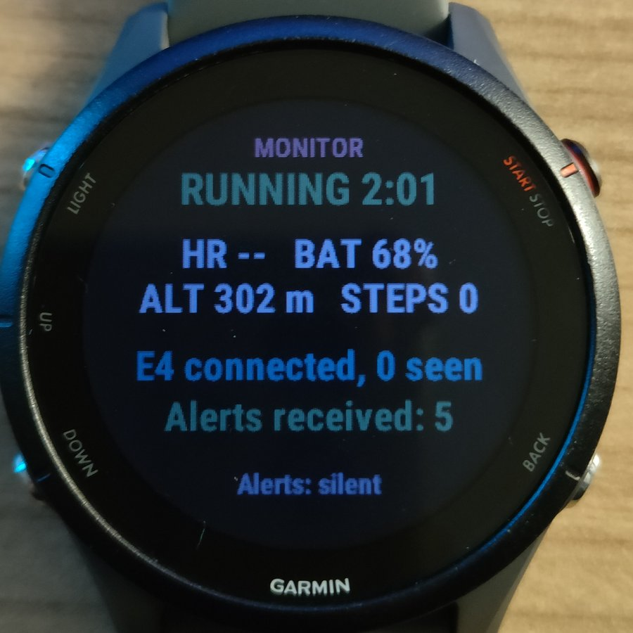
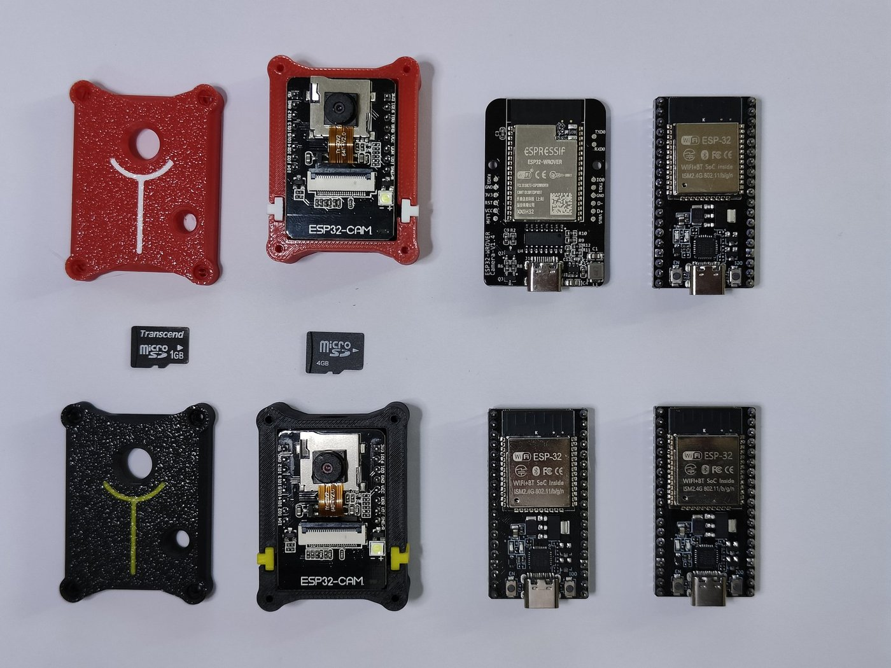
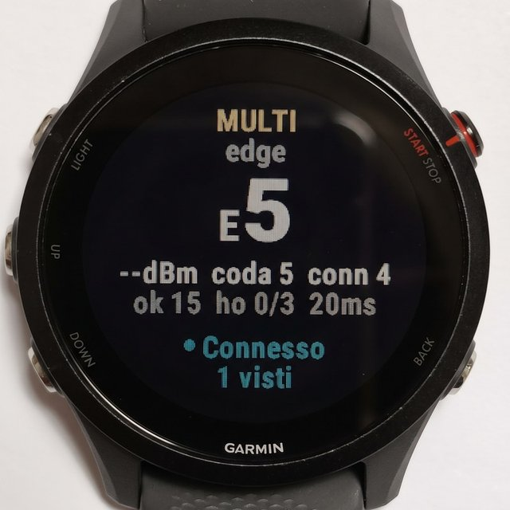
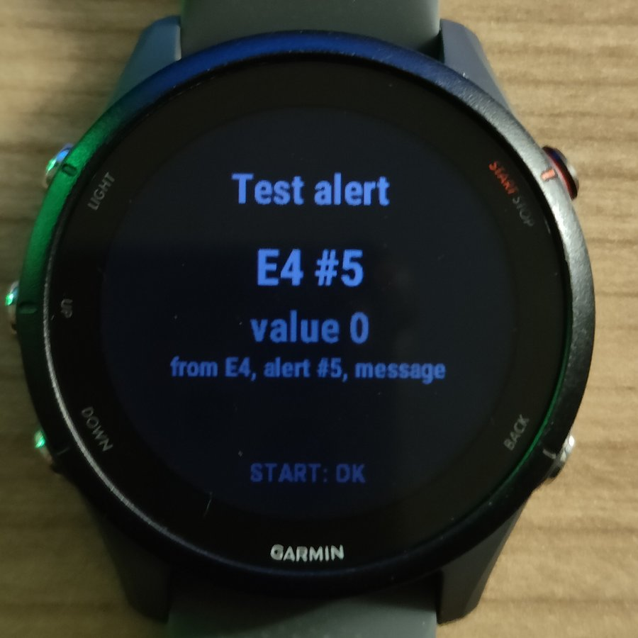
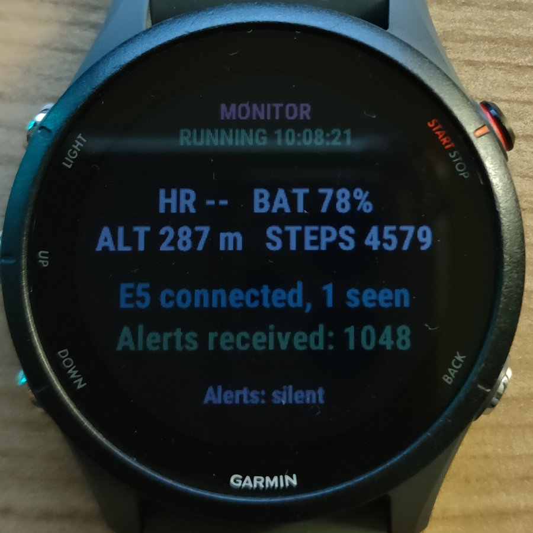

# Garmin_BLE_data_transfer

**Connect IQ** apps for the **Garmin Forerunner 255** that send the watch data over
**Bluetooth Low Energy** to one or more **ESP32** boards (ESP-IDF, NimBLE stack). The ESP32
boards reassemble and validate the packets, print them on the console and save them to
microSD. A Python script then rebuilds the sessions from the files of all the boards.

<p align="center">
  
  
</p>
<p align="center"><sub>
  Left: the BLE-Monitor app on the Forerunner 255, connected to edge E4.
  Right: the edge fleet — two ESP32-CAM AI-Thinker boards with microSD in 3D-printed
  cases (nodes 1–2, lids on the left), an ESP32-WROVER camera board without microSD
  (node 3) and three ESP32 development boards (nodes 4–6).
</sub></p>

The project contains:

- **five watch apps** built from a single source tree: four data fields and one device
  app;
- **a single ESP32 firmware** that serves all the apps and is configured per board with
  a few lines;
- **Python tools** to check the binary formats and rebuild the collected data.

## The apps

| App | Type | Protocol | What it does |
|---|---|:---:|---|
| **BLE-Full** | data field | v3 | every 5 s sends 12 activity values in a complete packet (3 chunks) |
| **BLE-Delta** | data field | v3 | every 5 s sends only the values that changed beyond a threshold (1–3 chunks) |
| **BLE-Batch** | data field | v3 | samples every 5 s and sends a block of 6 samples every 30 s |
| **BLE-Multi** | data field | v4 | delivers the samples to the edge with the best signal among several ESP32 boards, switches edge while moving and keeps in a queue whatever is not yet confirmed |
| **BLE-Monitor** | device app | v5 | sends heart rate, battery, steps and altitude while the app is open, and receives **alerts** from the edges (message, vibration, sound) |

Full, Delta and Batch sample the same data at the same rate and change only the radio
strategy: they are used to compare the battery consumption of the watch. All the data
fields transmit **only while the timer is running** and write the watch battery as a
developer field in the FIT file of the activity.

<p align="center">
  
  
  
</p>
<p align="center"><sub>
  BLE-Multi connected to edge E5 (photo of an earlier build with Italian labels:
  <i>coda</i> = queue, <i>Connesso</i> = Connected, <i>visti</i> = seen) ·
  a test alert on BLE-Monitor · BLE-Monitor after a continuous 10-hour session.
</sub></p>

## How it works

```
  Garmin FR255                                        ESP32 (one or more "edges")
 ┌──────────────────────────┐   write DATA (20 B      ┌──────────────────────────────┐
 │ sensors → sample         │   chunks: 4 B header    │ NimBLE GATT server           │
 │   → packet (v3/v4/v5)    │   + payload ≤ 16 B)     │   reassembles, validates, CRC│
 │   → chunks ──────────────┼───────────────────────► │   ACK = outcome of the last  │
 │                          │                         │         write (v4, v5)       │
 │ Monitor: alerts ◄────────┼──── notify ALERT ────── │ simulated alerts (v5)        │
 │                          │     (20 B, v5 only)     │ SD task (core 1) → CSV       │
 └──────────────────────────┘                         └──────────────────────────────┘
        ▲  advertising: Service UUID + Manufacturer Data (node ID, "busy" bit)
        └─ with several edges the watch picks the best one by RSSI and hands off
```

- **Transport (v3).** Connect IQ does not allow writes longer than 20 bytes, so every
  packet travels in *chunks* with a 4-byte header: packet ID, format, chunk index and
  count, and a bitmask for DELTA packets. Everything goes through **a single GATT
  characteristic**, so the number of writes reflects the strategy of the variant.
- **Multi-edge (v4).** Every edge advertises its own ID and a *busy* bit, and keeps
  doing so while connected. The watch filters the RSSI, picks the best edge and hands
  off with hysteresis. Every packet carries the session, the sequence number and the
  connection number, so the files of the various edges can be merged. A packet is
  confirmed by the outcome of the write of its last chunk; until then the samples stay
  in a one-hour queue on the watch.
- **Monitor (v5).** Uses the v4 radio with a more compact packet (12 bytes per sample)
  and a second characteristic, ALERT, on which the edge notifies the alerts.

The complete binary specification is in [docs/protocol.md](docs/protocol.md) (v3, v4) and
[docs/v5_monitoring.md](docs/v5_monitoring.md) (v5).

## Requirements

**Hardware**
- Garmin **Forerunner 255**: it is the only device in the manifests and the one the
  project was tested on.
- One or more **classic ESP32** boards. The ESP32-CAM AI-Thinker has a microSD slot; the
  other modules work as edges without SD, with the data on the console only.
- A **FAT32 microSD** card for every edge that has to record.

**Software**
- **VS Code** with Garmin's **Monkey C** extension, **Java JDK 17+**, the **Connect IQ SDK**
  (tested with 8.4.1, installed with the SDK Manager) and a **developer key**
  (*Monkey C: Generate a Developer Key*).
- **ESP-IDF v5.5** for the firmware.
- **Python 3**, standard library only, for the tools in `tools/`.
- A host **gcc**, to run the firmware tests.

How to install and configure the two environments, step by step and with links to the
official Garmin and Espressif guides, is explained in
[docs/guide.md § 1](docs/guide.md#1-prerequisites-once-per-pc).

## Configuration

### Watch

There are no machine paths in the repository. In the **user** settings of VS Code, set:

- `monkeyC.javaPath` → the JDK folder;
- `monkeyC.developerKeyPath` → the developer key file.

The build script finds the SDK that is active in the SDK Manager by itself. Without
those settings it uses `JAVA_HOME` (or `java` on the `PATH`) and
`%USERPROFILE%\.garmin\developer_key`.

The tunable parameters are constants in the code:

| File | What it contains |
|---|---|
| [source/Config.mc](source/Config.mc) | sampling rate, BATCH size, DELTA thresholds, Multi parameters (accepted edge IDs, choice window, RSSI filter, handoff hysteresis and timings, queue, timeouts) |
| [source-monitor/MonCfg.mc](source-monitor/MonCfg.mc) | Monitor parameters: tick, queued alerts, subscription timeout, alert modes |
| `variants/<name>/` | for every app: build jungle, manifest (UUID and permissions) and `VariantConfig.mc` with `Variant.ID` and `Variant.NAME` |

The watch connects to edges with IDs **1 to 10** (`MULTI_NODE_MIN..MAX`): a new edge in
this range is added without rebuilding the apps.

### ESP32

The firmware is the same for every board. The differences are a few lines at the top of
[esp32/main/src/ble.c](esp32/main/src/ble.c):

```c
#define THIS_EDGE_NODE_ID      1    // edge ID, 1..254 (the watch accepts 1..10)
#define THIS_EDGE_HAS_SD       1    // 1 = the board has the microSD slot, 0 = no
#define THIS_EDGE_ON_S         10   // pass-by simulation: seconds visible...
#define THIS_EDGE_OFF_S        0    // ...and invisible, in a loop; 0 = simulation off
#define THIS_EDGE_EVENT_S      30   // simulated alerts for the Monitor every N s; 0 = none
#define THIS_EDGE_EVENT_ALERT  4    // 0 message, 1 vibration, 2 sound, 3 both, 4 rotating
```

- Every board must have a **different ID**: the ID ends up in the advertising, in the BLE
  name (`EDGE-<id>`) and in the names of the files on SD. Out-of-range values stop the
  build.
- The **pass-by simulation** is for bench tests: the edge stays visible for `ON_S`
  seconds and invisible for `OFF_S`, closing the connection, as if the watch went past
  the edge.
- SD paths, write period, queue sizes and the core of the SD task are in
  [esp32/main/include/config.h](esp32/main/include/config.h). The NimBLE and FATFS
  options are in `esp32/sdkconfig.defaults`.

At boot the edge prints its whole configuration in one line, for example
`BLE peripheral started: edge node 1 ('EDGE-1'), SD present, always on, V5 alerts every 30 s (rotating), protocols v3/v4/v5`.

## Usage

**1. Build the apps.** In VS Code `Ctrl+Shift+B` → *Build* → the variant (`full`,
`delta`, `batch`, `multi`, `monitor` or `all`). Alternatively, from PowerShell:

```powershell
powershell -ExecutionPolicy Bypass -File tools\build.ps1 multi monitor   # some variants
powershell -ExecutionPolicy Bypass -File tools\build.ps1                 # all
```

The output is `bin\<variant>.prg`, built for the FR255.

**2. Load them onto the watch.** Connect the FR255 over USB and copy the `.prg` files to
`GARMIN\APPS\`.
- The **data fields** are added to a data screen of an activity profile
  (*Data Screens → Data Field → Connect IQ Fields → BLE-…*). They transmit during the
  activity, with the timer running.
- The **Monitor** is opened from the app menu. UP/DOWN change the alert mode; BACK exits,
  after a confirmation.

**3. Flash the ESP32 boards.** From a terminal with ESP-IDF active, in the `esp32` folder:

```bash
idf.py set-target esp32                # once
idf.py -p <PORT> flash monitor         # e.g. COM5 or /dev/ttyUSB0
```

Before each board, set the `THIS_EDGE_*` lines (§ Configuration).

**4. Collect the data.** Every edge with SD writes CSV files:

| Protocol | File |
|---|---|
| v3 (Full, Delta, Batch) | `activity_N.csv`, one file per activity |
| v4 (Multi) | `multi_<session>_n<node>.csv` |
| v5 (Monitor) | `monitor_<session>_n<node>.csv` |
| v4 and v5 | `edge_n<node>_events.csv`: connections, duplicates, jumps, rejections |

For Multi and Monitor a session is spread over the SD cards of several edges. Once the
cards are copied into a folder (for example `sd\e1`, `sd\e2`), it is rebuilt with:

```bash
python tools/merge_multi.py sd --out session.csv
```

The script deduplicates by sequence number and separates the gaps due to edges without SD
from real losses. For the Multi it also summarises the battery and radio activity of the
watch, for the Monitor the session values. Exit code: 0 no loss, 1 no file to process
(or session without data), 2 samples lost, 3 conflicting copies.

The complete procedure, with field verification and troubleshooting, is in
[docs/guide.md](docs/guide.md).

## Tests

The binary formats have a reference implementation in Python, written from the
specification tables only. It produces the vectors used to test the real firmware modules
on the host:

```bash
python tools/check_header.py && python tools/check_v4.py && python tools/check_v5.py
cd esp32/main/test
gcc -I ../include test_header.c -o test_header && ./test_header
gcc -I stub -I ../include -Wall -Wextra test_v4.c ../src/multi.c -o test_v4 && ./test_v4
gcc -I stub -I ../include -Wall -Wextra test_v5.c ../src/monitor.c -o test_v5 && ./test_v5
```

The v4 and v5 tests corrupt every packet one bit at a time, in every position, and check
that the parser rejects them all. The watch code has no automated tests and is verified
on the device ([guide § Field verification](docs/guide.md#9-field-verification)).

## Repository layout

```
Garmin_BLE_data_transfer/
├── source/              shared Monkey C code (protocols, v3 and v4 radio, data fields)
├── source-monitor/      Monitor code (v5)
├── variants/            full, delta, batch, multi, monitor: jungle + manifest + VariantConfig.mc
├── resources/           icon, app names, FIT field metadata
├── resources-monitor/   Monitor name
├── esp32/               ESP-IDF firmware (see esp32/README.md)
│   └── main/
│       ├── src/         ble.c (board configuration, GATT), sd.c, v4/v5 parsers and logs
│       ├── include/     protocol_v3/v4/v5.h, config.h, module interfaces
│       └── test/        host tests and generated vectors
├── tools/               build.ps1, Python format references, merge_multi.py
├── docs/                guide, protocol, architecture, v5 specification, photos (img/)
└── Garmin_BLE_data_transfer.code-workspace   project + esp32/ as two VS Code folders
```

## Documentation

| Document | Contents |
|---|---|
| [docs/guide.md](docs/guide.md) | prerequisites, build, loading, flashing the edges, Multi screen, app log, tests, field verification, consumption experiment, troubleshooting |
| [docs/protocol.md](docs/protocol.md) | v3 and v4 binary specification: the 12 values, GATT, transport header, CRC, formats, advertising, delivery, handoff, SD layout, known limitations |
| [docs/v5_monitoring.md](docs/v5_monitoring.md) | the Monitor and protocol v5: app, 4 values, uplink, alerts, SD recording |
| [docs/architecture.md](docs/architecture.md) | system diagrams and file-by-file description |
| [esp32/README.md](esp32/README.md) | firmware: architecture, queues, ACK, board configuration, SD logging, tests |

## Known limitations

- While the watch is connected, the RSSI of the current edge can stay frozen: the
  better-signal handoff may then never fire, and the watch changes edge only when the
  link drops.
- Draining the queue after a long time without edges is slow (about 40 samples in one
  minute with v4).
- An edge without SD confirms the packets and then discards them: those samples are not
  recorded anywhere (`merge_multi.py` reports them separately).
- Monitor alerts are not retransmitted: if the watch is not connected, they are lost.

Details and possible improvements in
[docs/protocol.md § Known limitations](docs/protocol.md#known-limitations) and
[docs/v5_monitoring.md](docs/v5_monitoring.md#possible-extensions).

## License

Released under the MIT license: see [LICENSE](LICENSE).

Garmin, Forerunner and Connect IQ are trademarks of Garmin Ltd. or its subsidiaries.
This project is not affiliated with or endorsed by Garmin.
