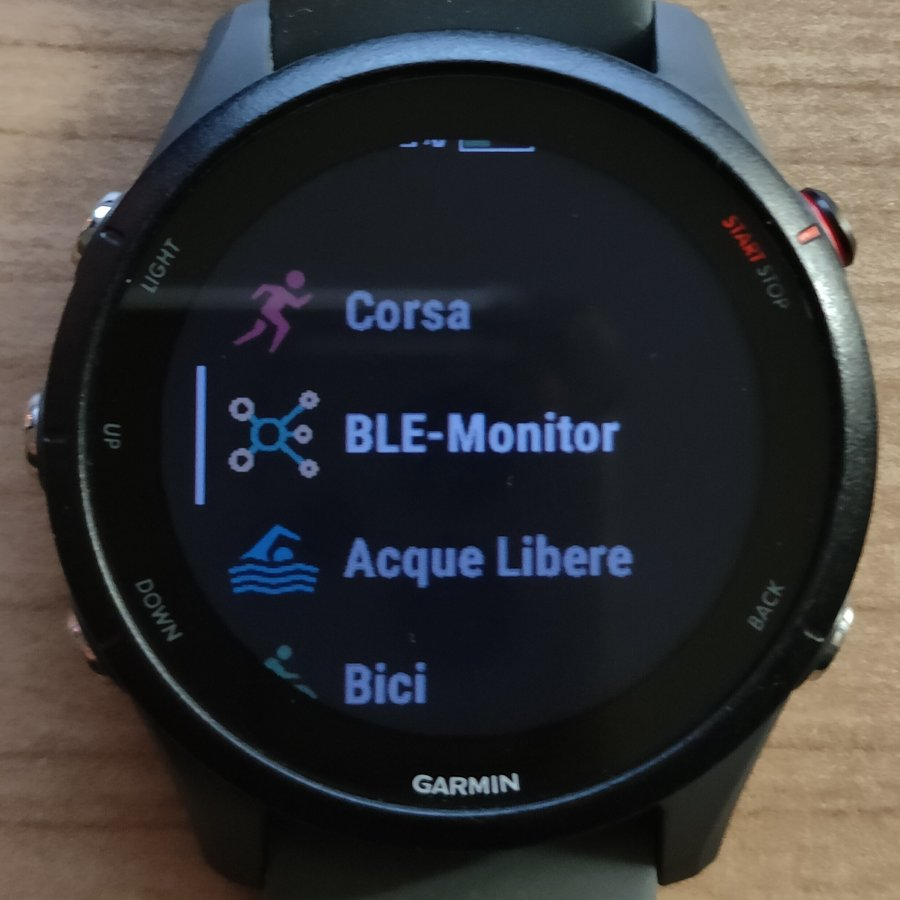
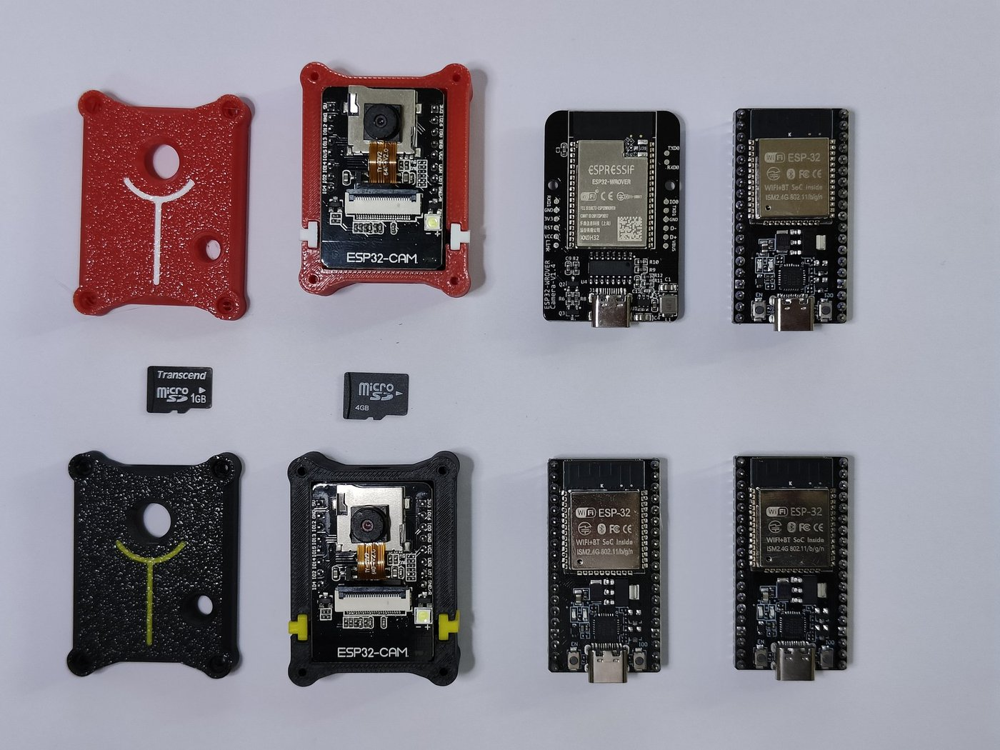
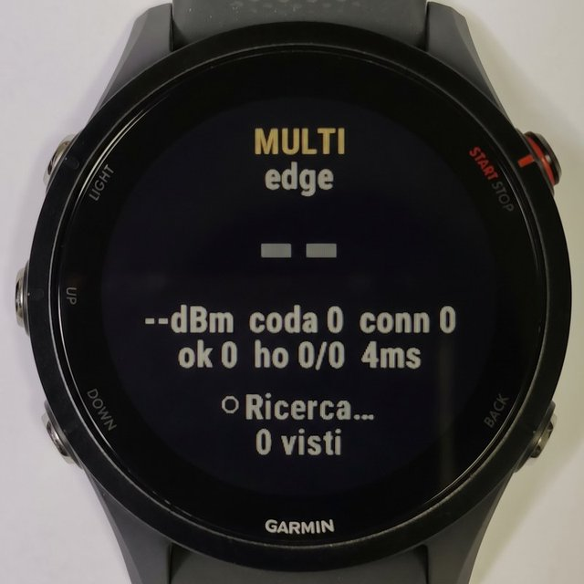
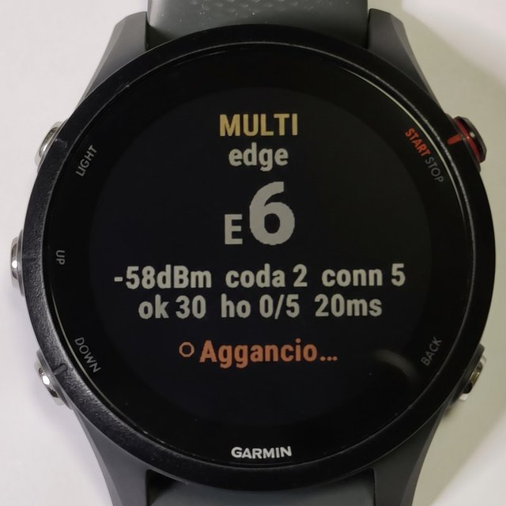
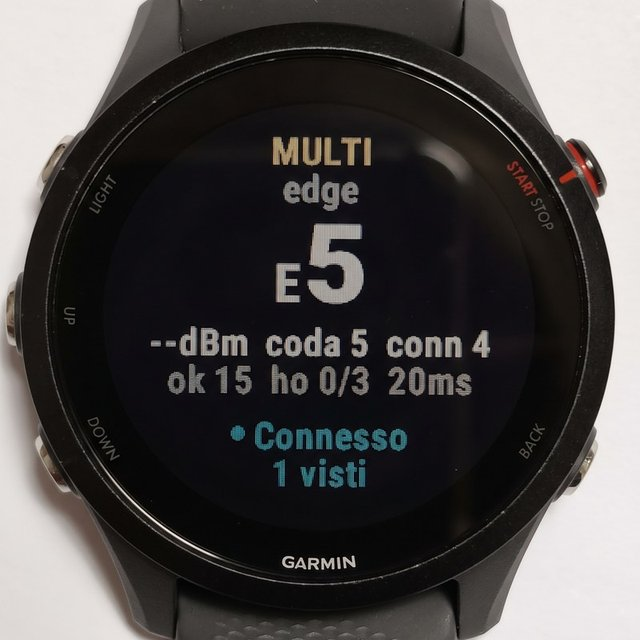

# Guide — Garmin_BLE_data_transfer

The path from installation to the experiment: **build** the data fields (Full / Delta /
Batch of protocol v3, **Multi** of v4), **load them onto the watch**, **flash the
ESP32 boards**, **verify** data and tests, and run the **experiment**. The binary format
is in [protocol.md](protocol.md), the structure of the code in
[architecture.md](architecture.md). The **Monitor** device app (v5) has its own guide in
[v5_monitoring.md](v5_monitoring.md).

> The builds share `source/`; each one has its own `variants/<name>/` folder with
> jungle, manifest and `VariantConfig.mc`. Output: one `.prg` per app, built for the
> watch: `bin/full.prg`, `bin/delta.prg`, `bin/batch.prg`, `bin/multi.prg`,
> `bin/monitor.prg`.

> **Multi** is the protocol v4 variant: several ESP32 edges, the watch connects to the
> one with the best signal. It is not part of the consumption comparison. For the Multi
> ESP32 boards see § 5.

> **The apps are tested on the watch** (§ 4): the project has no Monkey C tests and no
> simulator configurations.

**Contents** — 1 Prerequisites · 2 Build · 3 Command-line build · 4 Watch ·
5 ESP32 edges (Multi) · 6 Multi screen · 7 FIT fields · 8 Tests · 9 Field verification ·
10 Battery experiment · 11 Command summary · 12 Troubleshooting

---

## 1. Prerequisites (once per PC)

Two environments are needed: **Connect IQ** to build the watch apps and **ESP-IDF** for
the ESP32 firmware. Plus Python for the tools in `tools/`.

| What | Tested version | Purpose |
|---|---|---|
| VS Code + **Monkey C** extension (Garmin) | — | editor and app builds |
| Java JDK | 17 | required by the Monkey C compiler |
| Connect IQ SDK + Forerunner 255 device | 8.4.1 | building the apps |
| ESP-IDF | 5.5.4 | building and flashing the firmware |
| Python 3 | 3.11 | tools in `tools/` (standard library only) |
| Host gcc | — | firmware tests only (§ 8) |

### a) Connect IQ environment (watch)

Official Garmin guides:
[Get the SDK](https://developer.garmin.com/connect-iq/sdk/) (installing the SDK
Manager, the SDK and the extension) and
[Getting Started](https://developer.garmin.com/connect-iq/connect-iq-basics/getting-started/)
(introduction to Connect IQ and a first app).

1. Install **VS Code** and a **JDK** 17 or later (for example
   [Eclipse Temurin](https://adoptium.net/)).
2. From the [Get the SDK](https://developer.garmin.com/connect-iq/sdk/) page download and
   run the **SDK Manager**. With the manager download the **SDK** and the device files,
   at least the **Forerunner 255**, and accept to make that SDK the active one. The page
   offers the latest version; the project was tested with 8.4.1, which can be chosen from
   the list in the manager.
3. In VS Code, *Extensions* view, install the **Monkey C** extension published by Garmin
   and restart VS Code.
4. Create the developer key with *Monkey C: Generate a Developer Key* (command palette,
   `Ctrl+Shift+P`).
5. In the **user** settings of VS Code (not the project ones) set:
   - `monkeyC.javaPath` → the JDK folder;
   - `monkeyC.developerKeyPath` → the key file.
6. *Monkey C: Verify Installation* checks that everything is in place.

The repository contains **no machine path**, so after a clone there is nothing to
change. `tools/build.ps1` finds by itself:

- **the SDK**: the one active in the SDK Manager;
- **Java and the key**: from the two settings above, which the task passes to it. If they
  are missing, it uses `JAVA_HOME` or the `java` on the PATH, and the key in
  `%USERPROFILE%\.garmin\developer_key`.

`.vscode/settings.json` contains only project settings, the same on every PC.

### b) ESP-IDF environment (ESP32)

Official Espressif guides:
[Get Started, ESP-IDF v5.5 for ESP32](https://docs.espressif.com/projects/esp-idf/en/v5.5/esp32/get-started/index.html)
(Windows, Linux and macOS) and, for Windows,
[Standard Setup of Toolchain for Windows (v5.5.4)](https://docs.espressif.com/projects/esp-idf/en/v5.5.4/esp32/get-started/windows-setup.html).
The most recent versions of the documentation install through the **ESP-IDF Installation
Manager (EIM)**:
[Installation of ESP-IDF and Tools on Windows](https://docs.espressif.com/projects/esp-idf/en/latest/esp32/get-started/windows-setup.html).

1. Install **ESP-IDF v5.5** (the project was tested with 5.5.4) with the Windows
   installer or with EIM; on Linux and macOS follow the Get Started page.
2. The installation path must be shorter than 90 characters, with no spaces or
   parentheses.
3. The `idf.py` commands are run from a terminal with the ESP-IDF environment active: on
   Windows the **ESP-IDF PowerShell** terminal created by the installer, on Linux and
   macOS after `. $IDF_PATH/export.sh`.
4. Optional: Espressif's **ESP-IDF** extension for VS Code. The workspace
   `Garmin_BLE_data_transfer.code-workspace` opens `esp32/` as a folder of its own; the
   settings the extension writes in `esp32/.vscode/` (ESP-IDF folder, COM port) stay out
   of git.
5. Check, from the `esp32` folder: `idf.py set-target esp32`, then `idf.py build`. The
   `sdkconfig` is generated from `sdkconfig.defaults` at the first build.

Flashing and board configuration are in § 5.

### c) Python and gcc

- **Python 3** for `tools/merge_multi.py` and the format references (`check_*.py`):
  the standard library is enough.
- A host **gcc** (on Windows for example MinGW-w64) is needed only to build the firmware
  tests (§ 8). The ESP-IDF one builds for the ESP32, not for the PC.

---

## 2. Building (VS Code task)

`Ctrl+Shift+B` → **Build** task → pick the variant (`full`, `delta`, `batch`, `multi`,
`monitor` or `all`).

- The task writes `bin\<variant>.prg`, built for the watch (`-d fr255`).
- Compiler errors and warnings appear in the *Problems* panel and are clickable.
- The task is in `.vscode/tasks.json` and runs `tools/build.ps1` (§ 3).

---

## 3. Building from the command line (PowerShell)

From the project folder:

```powershell
powershell -ExecutionPolicy Bypass -File tools\build.ps1 multi              # one variant
powershell -ExecutionPolicy Bypass -File tools\build.ps1 full delta batch   # several variants
powershell -ExecutionPolicy Bypass -File tools\build.ps1                    # all
```

- At start-up the script prints the SDK, the Java and the key it found (§ 1). They can
  be forced with `-Sdk <SDK folder>`, `-JavaHome <JDK folder>` and `-Key <file>`.
  `-Device` changes the target, which is `fr255` by default.
- A new `variants/<name>/` folder with `<name>.jungle` is built without touching the
  script. To have it in the task too, add the name to the `options` of the `variant`
  input in `tasks.json`.
- If a build fails, the script exits with 1.

---

## 4. Loading onto the real WATCH (Forerunner 255)

### a) Copying the `.prg` files to the watch
1. Connect the FR255 over USB (it shows up as a storage drive).
2. Copy the `.prg` files you need from `bin\` to the **`GARMIN\APPS\`** folder of the watch.
3. Eject safely and wait for the watch to register the apps.

### b) Using the data fields
A data field is **not** an app of its own: it is added to a data screen of an activity
profile. `Settings → Activities & Apps → (e.g. Walk) → Data Screens → Add/Edit →
Data Field → Connect IQ Fields → BLE-Full` (or Delta/Batch/Multi).

> **Multi**: the watch needs `bin\multi.prg`. The file name in `GARMIN\APPS\` does not
> matter. The screen is explained in § 6.

- BLE sending and FIT writing are active **only during a started activity** with the
  data field on a data screen.
- For the battery experiment it is convenient to create **three activity profiles**, one
  per variant, so that every FIT has a distinct `dev_variant`.

### c) Using the Monitor (v5)
It is a **device app**: it is opened from the app list, not from a data screen. The watch
needs `bin\monitor.prg` (**Build** task → `monitor`), and the edges must be reflashed
with the firmware that has the v5 parser.

<p align="center">
  
</p>
<p align="center"><sub>
  BLE-Monitor in the app list of the watch, between the activities (the system menus
  follow the language of the watch, Italian here).
</sub></p>

- The session is the open app: data start when it opens and stop when it exits (BACK,
  with confirmation).
- UP/DOWN change the alert mode, written at the bottom: `as edge`, `silent`, `sound`,
  `vibrate`.
- Alerts from the edges are confirmed with START or BACK.

Details in [v5_monitoring.md](v5_monitoring.md).

---

## 5. ESP32 edges for the Multi variant (protocol v4)

There is **only one** firmware. Between one board and another only **a few adjacent
lines** change in `esp32/main/src/ble.c`, under a comment with the fleet table: the first
two say **which board** it is, the others **how it behaves** in the test.

```c
#define THIS_EDGE_NODE_ID  1    // 1..254, different for every board (the watch accepts 1..10)
#define THIS_EDGE_HAS_SD   1    // 1 = the board has the microSD slot, 0 = no
#define THIS_EDGE_ON_S     10   // simulation: seconds visible...
#define THIS_EDGE_OFF_S    0    // ...and seconds invisible, in a loop; 0 = simulation off
#define THIS_EDGE_EVENT_S      30  // simulated alerts for the Monitor (v5); 0 = none
#define THIS_EDGE_EVENT_ALERT  4   // how they appear: 0 message .. 4 rotating
```

The last two lines concern the Monitor only: see [v5_monitoring.md](v5_monitoring.md).
An example fleet, with six boards:

| Board | `THIS_EDGE_NODE_ID` | `THIS_EDGE_HAS_SD` |
|---|:---:|:---:|
| ESP32-CAM AI-Thinker | 1 | 1 |
| ESP32-CAM AI-Thinker | 2 | 1 |
| ESP32-CAM with ESP32-WROVER module, microSD slot not fitted | 3 | 0 |
| ESP32-WROVER | 4 | 0 |
| ESP32-WROVER | 5 | 0 |
| ESP32-WROVER | 6 | 0 |

<p align="center">
  
</p>
<p align="center"><sub>
  The fleet. Left: the two ESP32-CAM AI-Thinker boards with microSD (nodes 1–2), in
  3D-printed cases with their lids, and two microSD cards. Right: the ESP32-WROVER camera
  board without microSD (node 3) and three ESP32 development boards (nodes 4–6).
</sub></p>

All six are flashed **over USB, with no jumpers**: `idf.py -p <PORT> flash` puts them in
download mode by itself.

Six edges, **two with SD** (nodes 1 and 2): the activity starts and ends near one of
them, so its file is enough for the analysis (see § 5, "Battery and radio from a single
edge with SD").

Out-of-range values (ID outside 1–254, SD other than 0/1, `ON_S` outside 1–86400,
`OFF_S` outside 0–86400) stop the build.

> **Watch and edges are updated together.** The edge accepts only the protocol
> versions it knows (`proto_ver 0x05` for the Multi, `0x06` for the Monitor) and
> rejects the others. After a change to the format, flash **all** the edges and load
> the updated `.prg`.

For each board, from **ESP-IDF PowerShell** in the `esp32` folder:

1. set the lines (ID and SD according to the table, simulation and alerts according to
   the test) and save;
2. `idf.py -p <PORT> flash monitor` (for example `COM5` on Windows, `/dev/ttyUSB0` on Linux);
3. at boot check the whole configuration in one line, for example
   `edge node 3 ('EDGE-3'), SD ABSENT (data on the console only), SIMULATION on 10 s / off 120 s`
   (or `SD present`, `always on`).

Before a commit it is convenient to put the lines back to the reference values (node 1,
with SD, simulation off: `1` / `1` / `10` / `0`), so the repository does not change with
every flashed board.

- Only an ESP32-CAM connected through a USB-TTL adapter needs the `GPIO0`→`GND`
  jumper: see `esp32/README.md`, § Flashing an ESP32-CAM with a USB-TTL adapter.
- **Label** every board **physically** with its number: the ID is the only thing that
  tells them apart, and the files on SD carry it in their name.
- The watch accepts the IDs **from 1 to 10** (`Cfg.MULTI_NODE_MIN..MAX`): a new edge in
  this range is added by flashing the board, **without rebuilding the watch app**.
- An edge **without SD** (`THIS_EDGE_HAS_SD 0`) never attempts the mount (GPIOs 2, 14
  and 15 stay untouched), **always confirms** valid v4 packets to the watch and then
  discards them: the data stay on the console only. It never rejects for a full queue,
  so the watch does not abandon it. The same holds if the microSD is missing on a board
  that has the slot. It is a loss **accepted by design**, and `merge_multi.py` tells it
  apart from a real one (see below).
- **RSSI is not comparable across different models**: different antennas and circuits
  give different values at the same distance, and the handoff (8 dB hysteresis) tends to
  prefer the board with the better antenna. For measurements, note the RSSI of every
  board at a known distance.

### Pass-by simulation (bench tests)

In the field the watch enters the range of an edge for a few seconds and then moves
away. On the bench the watch stays still, so it is the **edge** that disappears: it stays
**on** (visible and connectable) for `THIS_EDGE_ON_S` seconds, then **off** (invisible)
for `THIS_EDGE_OFF_S`, and starts over. For example `10` / `120` reproduces a 10 s pass
every 2 minutes.

- "Off" stops the radio only: the edge closes the connection in progress and stops
  advertising. SD, numbering and files go on. At boot the cycle starts **on**, and every
  board counts from its own start-up (the windows of several edges are not synchronised).
- The watch sees an immediate disconnection and goes back to searching; the samples stay
  in the queue and leave towards the next visible edge.
- The events of the edge show `sim_off` / `sim_on` and the `disconnect` with reason
  **`0x216`** (closed by the edge), distinct from `0x213` (watch) and `0x208` (link lost).
- The useful window is shorter than `ON_S`: 1.5 s of choice, the pairing, then draining
  the queue built up while the edge was off (with `OFF_S 120` that is 24 samples, 6
  packets of 13 chunks). If they do not fit, the queue grows from cycle to cycle: it is a
  result to measure, not an error.

Details in `esp32/README.md`, § Pass-by simulation.

At the end of the activity copy the cards of the edges with SD into `sd\e1`, `sd\e2`, …
and:

```powershell
python tools/merge_multi.py sd --out session.csv
```

It reports unique samples, duplicates, samples left on the watch, the edge sequence and
the gaps, split into two lines:

- **To edges without files** — samples delivered during a connection that appears in no
  file: an edge without SD (or a card not copied). Accepted loss.
- **LOST** — samples that no edge received (watch queue overflowed). It is the only real
  loss, and it makes the script exit with code 2.

The distinction uses `conn_no`, the progressive connection number written in every row:
if a connection number is missing in the gap, that connection went to an edge without
files. The complete field verification procedure is in § 9.

### Battery and radio from a single edge with SD

Besides the battery, every sample carries the **radio telemetry** of the watch
(fields 4–7, see [protocol.md](protocol.md#protocol-v4--multi-edge)): counters that are
**cumulative** since the start of the activity. That is why a single edge with SD, where
the activity **starts and ends**, is enough: even with only two rows in its file,
`merge_multi.py` prints the summary of the whole activity, including the stretch spent
on the edges without SD.

```
Battery and radio (from seq 0 to seq 719, 2 samples with battery):
  elapsed time               59.9 min
  battery                 85.00 % -> 81.50 %   drop 3.50 points   (3.50 %/h)
  connected                  2400 s    66.8 % of the time
  pairing                      40 s     1.1 %
  scan on                    3590 s    99.9 %
  pairings                      8 succeeded out of 9 attempts
  end of connection             3 intended handoffs, 5 lost links
  chunks sent                2600   failed packets 2
  at the last sample     radio=connesso, RSSI -58 dBm, coda 0
```

The radio state and the `coda` (queue) field keep the names used in the data files and
on the ESP32 console: `ricerca` = searching, `aggancio` = pairing, `connesso` = connected.

The values are **differences between the first and the last sample** of the file. For
them to cover the whole activity:

- start the activity near the edge with SD and wait for it to connect (`● Connected`)
  before moving away;
- at the end go back near the edge with SD and **wait for `queue 0`** before stopping the
  timer: the samples still queued would reach no SD.

With the roaming scan always on, `scan on` grows together with the total time: its cost
can only be isolated by comparing tests with different scan settings.

---

## 6. The Multi variant screen

On a full screen the texts are in Roboto 18 px (`FONT_TINY`) and the edge number in big
bold (`FONT_NUMBER_HOT`):

```
        MULTI                ← variant name (yellow)
        edge
         E2                  ← current edge, big
  -67dBm  queue 0  conn 4    ← signal of the current edge, waiting samples, connections
  ok 142  ho 2/1  4ms        ← delivered, handoffs/lost links, compute() peak
      ● Connected            ← radio state
       3 seen                ← detail: edges seen right now (or "roam off")
```

On half a screen there is not enough room: compact characters (13 px), no "edge", and the
state on **one** line (`● Connected, 3 seen`).

<table align="center">
  <tr>
    <td align="center"></td>
    <td align="center"></td>
    <td align="center"></td>
  </tr>
  <tr>
    <td align="center"><sub>Searching: no edge yet</sub></td>
    <td align="center"><sub>Connecting to E6 (grey number, orange state)</sub></td>
    <td align="center"><sub>Connected to E5, 5 samples queued</sub></td>
  </tr>
</table>

<p align="center"><sub>
  Photos of an earlier build whose labels were in Italian; layout, colours and values are
  those of the current build. <i>Ricerca…</i> = Searching…, <i>Aggancio…</i> =
  Connecting…, <i>Connesso</i> = Connected, <i>coda</i> = queue, <i>visti</i> = seen.
  The connected photo shows <code>--dBm</code> while connected: see
  <a href="protocol.md#known-limitations">protocol.md § Known limitations</a>.
</sub></p>

| Element | Meaning |
|---|---|
| `E2` | connected edge. **White** = connected; **grey** = connection in progress (it is the edge being tried); `--` = none |
| `-67dBm` | **filtered** RSSI (moving average) of the current edge, measured from its advertising. While connected it must be a number: if it stays `--dBm` the current edge is not seen by the scan and the better-signal handoff cannot fire |
| `queue N` | samples measured but **not yet confirmed** by an edge. Healthy link: 0–1. Uncovered area: +1 every 5 s. On reconnection it drains at 4 samples per packet |
| `conn N` | **successful connections** in the session, i.e. how many times the watch connected to an edge (any), including the current connection. Restarts from 1 at the start if already connected |
| `ok N` | **confirmed** samples (samples, not packets): +1 every 5 s |
| `ho A/B` | A = **intended** edge changes (better signal); B = links **lost** or abandoned because of errors |
| `Nms` | **maximum** time of `compute()` since the field started: the margin to the watchdog. The worst case comes while draining the queue |

Radio state, on two centred lines. The dot is **drawn** (filled = connected, empty =
searching or connecting): the watch fonts do not have the ● ○ ◌ symbols, which would come
out as `?`.

| First line | Second line | Colour | Meaning |
|---|---|---|---|
| `○ Searching…` | `3 seen` | grey | no edge; the number counts the **registered** edges seen right now |
| `○ Connecting…` | — | orange | connection in progress to the edge shown big (if it does not succeed within 10 s, it retries excluding that edge for 10 s) |
| `● Connected` | `3 seen` | blue | connected, roaming scan active; the number counts the registered edges received in the **last 5 s**, **including** the current one |
| `● Connected` | `roam off` | orange | connected, but the stack refuses the scan while connected: the handoff happens only when the link drops |

Good to know:

- The connection is established **even before the start**, but `queue` and `ok` stay at
  0: sampling happens only with the timer running. At a "fresh" start (not the resume
  from pause) `ok` and `ho` restart from zero and `conn` from 1 (or 0 if not connected),
  because a new session begins.
- The samples dropped because of a **full queue** (more than an hour without edges) do
  not appear on screen: at the end of the activity they show up as "LOST" in
  `merge_multi.py`.
- Like the other variants, it writes the battery in the FIT; `dev_variant` = 5.

---

### Diagnostics: the app log on the watch

The Multi variant writes a **log** with one line every 10 s and one for every connection
event. On the watch it is off until the file is created:

1. connect the FR255 over USB;
2. create an **empty** text file in `GARMIN\APPS\LOGS\` with the **same name as the
   `.prg`** loaded and the `.TXT` extension (for `multi.prg` → `MULTI.TXT`);
3. run the test; at the end connect the watch again and copy that file.

Without the file the app writes nothing (zero cost). Example lines:

```
MULTI 812s connected to E2 (conn 3)
MULTI 820s CONN E2 scan=1 roam=1 adv=37 advE=0 rssiE=-- ema=-- vis=2 chunks=26 samples=8 queue=31 conn=3
MULTI 905s leaving E2: handoff to E1
```

| Field | Meaning |
|---|---|
| `CONN` / `PAIR` / `SCAN` | radio state: connected, pairing, searching |
| `adv` | advertising packets of registered edges received in the 10 s |
| `advE` / `rssiE` | how many of them came from the **current edge**, and the last raw RSSI. While connected, `advE=0` means the watch does not receive the advertising of the edge it is connected to: the dBm on screen cannot update |
| `ema` | the filtered RSSI shown on screen |
| `vis` | edges seen (as on screen) |
| `chunks` / `samples` | chunks and samples **confirmed** in the 10 s: while draining the queue they are the real speed of the link |
| `queue`, `conn` | as on screen |

The events (`connected to`, `leaving … : reason`, `pairDevice … failed`, `scan
refused`) say why the watch changed edge or lost the link.

---

## 7. Checking the FIT fields (after recording)

The data fields (Full, Delta, Batch, Multi) write two developer fields into the FIT of
the activity: `battery` (at every record) and `variant` (once). The Monitor does not write
to the FIT. The project has no scripts to read them: they can be read with any tool that
shows the developer fields of a FIT file.

### Where to get the `.fit`
- **Recommended**: the **raw** file over USB from `GARMIN\ACTIVITY\` (name like `YYYY-MM-DD-...fit`).
- From Garmin Connect (browser) only **"Export Original"** is fine; the **TCX/GPX**
  exports **remove** the developer fields.

### Seeing it on Garmin Connect
The **"Watch Battery" chart does not appear** for sideloaded apps: Garmin Connect applies
the fitContributions style only to apps **published on the Store**. The data is in the
FIT anyway.

---

## 8. Tests

The tests run **on the host** and check the ESP32 firmware against **vectors** generated
by an **independent** Python implementation of the formats, written from the
specification tables only. The watch side has no automated tests: it is verified in the
field (§ 9). Python 3 and a host `gcc` are needed.

- **Protocol v4 (C, on the host)** — parsing, rejection of every single-bit corruption,
  duplicates and jumps per node, advertising:
  ```bash
  python tools/check_v4.py          # (re)generates the vectors + self-check
  cd esp32/main/test
  gcc -I stub -I ../include -Wall -Wextra test_v4.c ../src/multi.c -o test_v4 && ./test_v4
  ```

- **v3 header symmetry (C, on the host)**:
  ```bash
  python tools/check_header.py
  cd esp32/main/test && gcc -I ../include test_header.c -o test_header && ./test_header
  ```

- **Protocol v5 (C, on the host)** — alerts, uplink parsing, every single-bit
  corruption, duplicates and jumps per node:
  ```bash
  python tools/check_v5.py          # (re)generates the vectors + self-check
  cd esp32/main/test
  gcc -I stub -I ../include -Wall -Wextra test_v5.c ../src/monitor.c -o test_v5 && ./test_v5
  ```

### What the tests CANNOT prove

What remains to be verified **in the field**, with a real watch and ESP32 boards: the
watch code (packets, store-and-forward queue, edge choice and handoff), the radio
behaviour (on-air chunking, alert subscription), reconnections, SD writing, and the
execution times. See § 9.

---

## 9. Field verification

These need the hardware: a real watch, ESP32 boards and microSD cards.

### MULTI variant

The automated tests cover format, parsing and duplicates on the ESP32 side. The queue and
the handoff policy of the watch are verified here, with the hardware. Two issues are
still open: the dBm that does not update while connected (step 3) and the slow draining of
the queue (see [protocol.md § Known limitations](protocol.md#known-limitations)).

Prepare: the ESP32 boards flashed each with its own ID (`THIS_EDGE_NODE_ID` and
`THIS_EDGE_HAS_SD` in `ble.c`; for example nodes 1–2 with microSD and 3–6 without) and
with the simulation **off** (`THIS_EDGE_OFF_S 0`) for steps 1–6, on power banks;
**BLE-Multi** data field on a data screen; app log active (§ 6).

**1. Identity.** With nRF Connect (or similar) the edges show up as `EDGE-<n>`,
with the Manufacturer Specific Data `FFFF 54 34 <n> 00`.

**2. Choice.** Near a single edge, start the activity: within a few seconds the screen
goes from `○ Searching…` to `● Connected` / `N seen` with a big `E<n>`. The monitor of
that edge prints a line every 5 s
`v4 S=<session> seq=<first>+<n> backlog=<backlog> conn=<n> hr=… radio=<ricerca|aggancio|connesso> rssi=<dBm|N/A> t_conn=<s>s`
(radio, rssi and t_conn come from the telemetry of the last sample of the packet;
`[DUP]` or `[JUMP]` when needed). On nRF Connect the same edge now shows as
**non-connectable** with the busy byte at `01`: this is what the handoff needs.

**3. Roaming.** If the screen shows `roam off`, the stack refuses the scan while
connected: the handoff will happen only on a lost link. If instead the RSSI stays at
`--dBm` while connected, the scan is on but the busy advertising of the current edge does
not arrive: same effect. Both are the first data point to note. With all the edges on and
in range, `N seen` must count all of them, including the current one: if it counts one
fewer, it is usually the current one that is missing (see `--dBm`).

**4. Handoff.** Move towards a second edge: after at least 15 s of connection and 3 s
of an advantage ≥ 8 dB, `E<n>` changes and `ho` (first number) grows. In
`edge_n<old>_events.csv` a `disconnect,…,0x213` appears.

**5. Uncovered area.** Move away from all the edges: `queue` grows by 1 every 5 s,
`ho` (second number, lost links) grows. Come back: the queue drains at 4 samples per
packet and goes back to 0.

**6. Rebuilding.** At the end of the activity copy the cards of the edges with SD into
`sd/e1`, `sd/e2`, … and run `python tools/merge_multi.py sd --out session.csv`:
**LOST = 0** unless there was an absence longer than one hour, **conflicts = 0**, and the
edge sequence must match the path walked. Passes near the edges without SD appear as
`--  edge without files (conn N)` rows: expected. Duplicates are expected (a few, at edge
changes). The **Battery and radio** section must report plausible values: connected and
pairing times consistent with the path, pairings equal to `conn` on screen, battery drop;
the smallest step of `watchBatt` gives the battery resolution.

**7. Execution time.** The `compute()` peak is on screen (`…ms`). Note it after draining
the queue: it is the worst case (building a 208-byte packet and its CRC in the write
callback).

**8. Simulated passes on the bench.** Reflash the edges with the simulation on (for
example `ON_S 10`, `OFF_S 120`) and leave the watch still next to them with the activity
started. At every window the watch must connect (`conn` +1), drain the queue and lose the
edge when it switches off (`ho`, second number, +1). From the watch log (`chunks=` in the
10 s lines) and from the `backlog` column of the edge files you can tell whether the
window is enough to drain the queue or whether the queue grows from cycle to cycle.

---

## 10. Battery experiment — procedure

> It concerns only the Full/Delta/Batch variants (protocol v3).

1. Install the three apps on the watch (release build).
2. Create **three activity profiles**, one per variant (so every recording uses a single
   app and the FIT has a distinct `dev_variant`).
3. For each variant: start the ESP32 (`idf.py monitor` for the console), start the
   activity with its profile, record under the same conditions.
4. At the end of the activity: extract the FIT (§ 7) and compare the battery consumption
   (`dev_battery`) of the three.
5. On the peripheral, the protocol DEBUG logs report counts per format and the
   **average popcount of the DELTA bitmasks** (useful for the Delta vs Full/Batch
   break-even). With the project configuration they are not compiled: enable them by
   raising the log level to Debug (see `esp32/README.md` § Console output).

---

## 11. Command summary

| Action | Command / Task |
|---|---|
| Build (for the watch) | `Ctrl+Shift+B` → **Build** → variant → `bin\<var>.prg` |
| Command-line build | `powershell -ExecutionPolicy Bypass -File tools\build.ps1 <var>` |
| Load onto the watch | Copy `bin\*.prg` to `GARMIN\APPS\` over USB |
| Build + flash an edge | the `THIS_EDGE_*` lines in `esp32\main\src\ble.c`, then `idf.py -p COMx flash monitor` |
| Merge the edge SD cards (v4 and v5) | `python tools/merge_multi.py <folder> --out session.csv` |

---

## 12. Troubleshooting

| Error / symptom | Cause / Solution |
|---|---|
| `Connect IQ SDK not found` | No SDK active in the SDK Manager → activate one, or pass `-Sdk` to the script (§ 3). |
| `Java not found` | Set `monkeyC.javaPath` (user settings) or `JAVA_HOME`, or put `java` on the PATH. |
| `Developer key not found` / `Unable to load private key` | Wrong key path → check `monkeyC.developerKeyPath`, or create it with *Monkey C: Generate a Developer Key*. |
| The *Build* task does not ask for the variant | The default task of `Ctrl+Shift+B` is another one: *Tasks: Run Task* → **Build**. |
| Icon warning 800×800 → 40×40 | Cosmetic only: the icon is resized. |
| FIT without `dev_battery`/`dev_variant` | Old build on the watch (rebuild + reload), or the FIT is a TCX/GPX export (use the raw file over USB). |
| "Watch Battery" missing on Garmin Connect | Expected for unpublished apps: the data is in the FIT anyway (§ 7). |
| `chunk: 3` fixed on screen | Normal: it is the number of chunks of the last packet (FULL = 48 B = 3 chunks), not a total. |
| Multi stays on `○ Searching…` / `0 seen` | The edges do not have the v4 firmware (the Manufacturer Specific Data is missing), or their ID is outside 1–10 (`Cfg.MULTI_NODE_MIN..MAX`). |
| Multi shows `roam off` | The stack refuses the scan while connected: the handoff happens only when the link drops. |
| While connected the dBm does not update | Enable the log (§ 6) and look at `advE` and `rssiE` while connected: `advE=0` = the advertising of the current edge does not reach the watch; `advE>0` with `rssiE` always the same = it arrives, but with an RSSI that does not change. |
| The edge disconnects by itself at regular intervals | The pass-by simulation is on (`THIS_EDGE_OFF_S` > 0): the boot line confirms it (`SIMULATION on … / off …`). For field use reflash with `OFF_S 0`. |
| Multi sees a single edge with two ESP32 boards on | The two boards have the same `THIS_EDGE_NODE_ID`: at boot both print the same `edge node N (…)`. Reflash one of them with another ID. |
