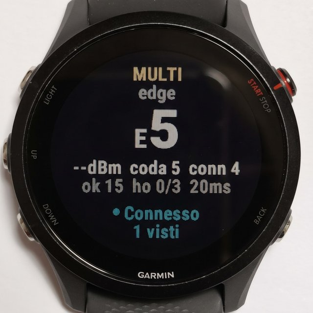

# Protocol — binary specification (v3, v4)

> This document is the **single source of truth** of the binary format. The tables are
> reproduced as comments in `source/Protocol*.mc` (Monkey C) and
> `esp32/main/include/protocol*.h` (C): the two sides **must** agree on the same
> interpretation. The C side is checked against the vectors of an independent Python
> reference, the watch side in the field (see [guide.md § Tests](guide.md#8-tests)).
>
> How the code is organised: [architecture.md](architecture.md). How to build and
> verify: [guide.md](guide.md). Protocol **v5** (Monitor) is in
> [v5_monitoring.md](v5_monitoring.md).
>
> **Versions.** **v3** = transport, FULL/DELTA/BATCH formats and CRC; **v4** = Multi
> (several edges); **v5** = Monitor (device app with alerts). v4 and v5 travel inside the
> v3 transport.

**Contents** — [The 12 values](#the-12-values-v3-logical-payload-fixed-order) ·
[GATT architecture](#gatt-architecture-binding-decision) ·
[v3 transport](#v3-transport-protocol) · [CRC](#crc) · [v3 formats](#the-v3-formats) ·
[v4 multi-edge](#protocol-v4--multi-edge) ·
[Behaviour of the variants](#behaviour-of-the-variants)

---

## The 12 values (v3 logical payload, fixed order)

The index `i` is also **bit `i`** of the DELTA bitmask.

> These are the values of the FULL/DELTA/BATCH formats. v4 reuses their geometry (with
> the radio telemetry in fields 4–7); v5 has 4 values of its own.

| bit | Field | Monkey C source | On-air encoding (uint32) |
|----:|-------|-----------------|--------------------------|
| 0 | currentHeartRate | Activity.Info | bpm |
| 1 | currentCadence | Activity.Info | spm/rpm |
| 2 | currentSpeed | Activity.Info | m/s × 100 (fixed-point) |
| 3 | elapsedDistance | Activity.Info | metres (truncated) |
| 4 | altitude | Activity.Info | metres **+ 10000** (offset for negative altitudes) |
| 5 | totalAscent | Activity.Info | metres |
| 6 | calories | Activity.Info | kcal |
| 7 | currentHeading | Activity.Info | rad × 1000 **+ 10000** |
| 8 | timerTime | Activity.Info | ms |
| 9 | battery | System.getSystemStats() | percent × 100 |
| 10 | elapsedTimestamp | Activity.Info.elapsedTime | ms since the activity started |
| 11 | realTime | Time.now().value() | epoch seconds UTC |

- All **uint32 BIG-ENDIAN**, no raw negative values (offsets are used instead).
- Every Activity.Info field can be `null` → sentinel **`0xFFFFFFFF`** = "missing
  data"; the ESP32 recognises it and prints `N/A`.

---

## GATT architecture (binding decision)

**A single DATA characteristic** (UUID `...DB5`), writable, receives the chunks of
**all** the formats, v4 and v5 included. **Not** 12 characteristics: with a single ATT
write in flight, 12 characteristics = 12 serialised writes per cycle → an almost constant
radio cost across the variants, which **would void the experiment**. With
"1 characteristic + chunking" the number of on-air writes reflects the strategy
(Full = 3, Delta = 1–3, Batch = 18 every 30 s) and becomes the measured variable.

The **ALERT** characteristic (`...DBB`, **NOTIFY**) carries the v5 alerts to the watch:
only the Monitor registers it (see [v5_monitoring.md](v5_monitoring.md)). The v3
variants register only DATA, so not even the discovery of ALERT enters the consumption
measurements.

**Protocol v4** adds no characteristics: it uses DATA like everyone else. Instead it
adds a **Manufacturer Specific Data in the advertising** (node ID and *busy* bit), which
is what lets the watch tell the edges apart.

---

## v3 transport protocol

Connect IQ **does not expose** MTU negotiation, and `Characteristic.requestWrite()`
throws `InvalidRequestException` **beyond 20 bytes**: it is a limit of the API, not of
the ATT MTU (the ESP32 already asks for `CONFIG_BT_NIMBLE_ATT_PREFERRED_MTU=256` and
nothing changes). Fragmentation is therefore mandatory. Every BLE write is a **chunk**:

```
chunk = HEADER (4 bytes) + PAYLOAD (1..16 bytes)
```

### Header — one uint32 word, sent BIG-ENDIAN

`header = (pktId << 24) | (flags << 22) | (idx << 17) | (cnt << 12) | bitmask`

| Bits | Field | Width | Meaning |
|------|-------|:-----:|---------|
| 31–24 | pktId | 8 | logical packet ID, mod 256; **identical** on all the chunks of the packet |
| 23–22 | flags | 2 | `00`=FULL, `01`=DELTA, `10`=BATCH, `11`=APP, v4/v5 application payload (`proto_ver` decides) |
| 21–17 | idx | 5 | index of the chunk in the packet (from 0); the payload is copied at offset `idx × 16` |
| 16–12 | cnt | 5 | total number of chunks (1–31); identical on all the chunks |
| 11–0 | bitmask | 12 | DELTA only: bit `i` = field `i` present. FULL/BATCH: = 0 |

**Mandatory symmetry** — building (Monkey C) and decoding (C) with explicit
shifts/masks only, **never C bitfields** (implementation-defined order). Widths and
shifts are defined in a single place per side (`ProtocolV3.mc` / `protocol_v3.h`).

### Payload

Sequence of big-endian uint32 fields **with no prefixes** (the bitmask is in the
header). Invariant **of the FULL/DELTA/BATCH formats only**: every full chunk carries
exactly **4 fields** (16 = 4 × 4 B); **no field is ever split** between two chunks. It
does not hold for `flags=11` (APP): v4/v5 packets can split a field between two chunks,
and it does not matter, because the reassembler is positional and does not interpret
the content. The last chunk can be short, **with no padding**. The ESP32 derives the
payload length from the length of the write (NimBLE) minus 4; reassembled size =
`(cnt−1)×16 + len(last chunk)`.

### Reassembly (ESP32)

One buffer at a time, key = `pktId`, positional copy at `idx×16`. Complete when `cnt`
distinct chunks of the same `pktId` have been received → parser chosen by `flags`.
A chunk with a `pktId` different from the one being assembled **discards** the
incomplete one (typical case: disconnection half way) and starts the new one. The
transport does not retransmit: the watch sends one chunk at a time, in order. Delivery is
confirmed only for v4 and v5, which write explicitly *with response* (§ Delivery); the v3
variants use Connect IQ's default write type, without response (see
[architecture.md § Technical notes](architecture.md#technical-notes)).

### Integrity checks (ESP32 — violation → packet dropped + DEBUG log)

1. `flags`, `cnt`, `bitmask` **identical** on all the chunks of the same `pktId`.
2. `idx < cnt`; no duplicate `idx`; non-last chunks are full (16 B).
3. **FULL**: size = exactly **48 B**; bitmask = 0.
4. **DELTA**: size = `4 × popcount(bitmask)`; bits **8, 10, 11** (timerTime,
   elapsedTimestamp, realTime) always set.
5. **BATCH**: bitmask = 0; `cnt % 3 == 0`; size = `cnt × 16`. Samples = `cnt / 3`.
6. **APP** (`flags=11`): bitmask = 0. The length cannot be checked at this level: the
   v4/v5 packet declares it itself (`n_samples`) and it is protected by its CRC-16.

> `flags=11` carries the **v4** and **v5** application protocols, which reuse this
> transport *entirely*: no build flag, no variant of the chunking. The ESP32 serves them
> together with the v3 formats because they are told apart here, and from each other by
> the `proto_ver` byte.

### CRC

Defined here, used by v4 and v5 (`ProtocolV3.mc` on the watch, `protocol_v3.h` on the
ESP32):

- **CRC-16/CCITT-FALSE**: poly `0x1021`, init `0xFFFF`, no reflect, no xorout.
  `crc16("123456789") == 0x29B1`. Closes the v4 and v5 packets (big-endian trailer).
  On the watch it is computed per nibble (16-entry table).
- **CRC-8**: poly `0x07`, init `0x00`, no reflect, no xorout. `crc8("123456789") == 0xF4`.
  Protects the v5 alerts.

---

## The v3 formats

### FULL (`flags=00`) — variant 1
12 fields in table order = **48 B = 3 chunks**.

### DELTA (`flags=01`) — variant 2
Only the fields whose bit is set, in increasing bit order; the `i`-th present field is at
offset `4×i`. Size = `4 × (3 + k)`, with `k` = changed data fields (0–9):

| k changed | Payload | Chunks | On-air bytes |
|:---:|:---:|:---:|:---:|
| 0 (keep-alive) | 12 B | 1 | 16 |
| 1 | 16 B | 1 | 20 |
| 2–5 | 20–32 B | 2 | 28–40 |
| 6–9 | 36–48 B | 3 | 48–60 |

With all the bits set the DELTA is byte-for-byte identical to a FULL (48 B, 3 chunks):
the worst case is not a special case, no fallback.

### BATCH (`flags=10`) — variant 3
N consecutive samples, each with the FULL layout (48 B). **No block header**:
`N = cnt / 3`. Standard block: **6 samples = 288 B = 18 chunks** every 30 s. Partial
block (flush on reconnection): `N×3` chunks.

> The `48 = 3×16` alignment is a design constraint: adding a 13th field would break it
> and require a block header to be reintroduced.

---

## Protocol v4 — multi-edge

**MULTI** variant (`Variant.ID = 5`). The same **12 values** as v3, the same rate
(**5 s**), but towards **several ESP32 boards**: the watch is connected to **one edge at a
time**, the registered one with the best signal, and **no sample is lost** until its
queue overflows.

> v4 travels on the v3 transport with `flags = 11` (APP): that code point carries a
> **self-describing** application payload, and the `proto_ver` byte (offset 1, magic
> `0xA5`) tells v4 (`0x05`) apart from v5 (`0x06`). No build flag: the same ESP32 binary
> serves v3, v4 and v5.
>
> **Routing on the ESP32**: `0x05` goes to the v4 parser, `0x06` to the v5 parser; any
> other value is rejected with an ATT error (`reject` event). This way a packet with a
> different version gets an error instead of being confirmed and lost, and after 3
> rejections the watch abandons the edge. **Watch and edges must therefore be updated
> together.**

### Identifying the edges — advertising

Besides the Service UUID, every edge advertises a **Manufacturer Specific Data**
(company id `0xFFFF`, reserved for testing by the Bluetooth SIG):

| Off | Type | Field | Notes |
|-----|------|-------|-------|
| 0 | uint8 | `magic0` | `0x54` `'T'` |
| 1 | uint8 | `magic1` | `0x34` `'4'` |
| 2 | uint8 | `node_id` | 1–254, fixed when the ESP32 is **built** |
| 3 | uint8 | `adv_flags` | bit0 **busy**: connected, **non-connectable** advertising |

Advertising packet: flags (3) + 128-bit UUID (18) + this AD (8) = **29 bytes out of
31**. The name in the scan response becomes `EDGE-<id>`.

**The edge keeps advertising while connected** (non-connectable, busy=1). It is the only
way the watch can know the RSSI of the edge it is connected to, because Connect IQ does
not expose the RSSI of an ongoing connection: without it, the handoff would have nothing
to compare against.

The watch connects only to the IDs from `Cfg.MULTI_NODE_MIN` to `Cfg.MULTI_NODE_MAX`
(currently **1–10**). The range is wider than the existing edges on purpose: a new edge
is added by flashing an ESP32 with its ID, without rebuilding the watch app; an ID with no
board does not advertise and is therefore never a candidate.

### Packet — FR255 → ESP32 (all big-endian)

**Header — 14 bytes**

| Off | Type | Field | Notes |
|-----|------|-------|-------|
| 0 | uint8 | `magic` | `0xA5` |
| 1 | uint8 | `proto_ver` | `0x05` |
| 2 | uint8 | `node_id` | **addressee** edge, read from its advertising |
| 3 | uint8 | `n_samples` | 1–4 |
| 4 | uint32 | `session_id` | UTC epoch (s) of the activity **start** |
| 8 | uint32 | `seq_first` | seq of the 1st sample; the following ones are +1 |
| 12 | uint8 | `backlog` | samples still queued **after** this one (saturates at 255) |
| 13 | uint8 | `conn_no` | number of the connection in the session (mod 256) |

**Samples** — `n_samples × 48 B`: **12 uint32 BE fields**, in the v3 order. Fields
0–3 and 8–11 are those of the v3 FULL payload (hr, cad, speed, dist, timer, battery
%×100, elapsed, realTime, with the same encodings and sentinels). Fields **4–7**, which
in v3 are altitude, ascent, kcal and heading, carry the **radio telemetry of the watch**,
read at the same instant as the battery. Same size, therefore same traffic.
**Trailer** — `uint16` BE, CRC-16/CCITT-FALSE ([§ CRC](#crc)) over everything else.

| Field | Name | Content (uint32 BE) |
|---|---|---|
| 4 | `tel_time` | `(t_conn_s << 16) \| t_scan_s` |
| 5 | `tel_link` | `(t_agg_s << 16) \| tx_chunks` |
| 6 | `tel_count` | `(n_try << 24) \| (n_conn << 16) \| (n_ho << 8) \| n_lost` |
| 7 | `tel_state` | `(n_fail << 24) \| (radio << 16) \| (rssi << 8) \| coda` |

| Value | Meaning | Type |
|---|---|---|
| `t_conn_s` | seconds connected to an edge | cumulative, mod 65536 |
| `t_scan_s` | seconds with the BLE scan on | cumulative, mod 65536 |
| `t_agg_s` | seconds pairing (`pairDevice` in progress) | cumulative, mod 65536 |
| `tx_chunks` | chunks written with a positive outcome | cumulative, mod 65536 |
| `n_try` | pairing attempts | cumulative, mod 256 |
| `n_conn` | successful connections | cumulative, mod 256 |
| `n_ho` | intended handoffs (better signal) | cumulative, mod 256 |
| `n_lost` | links lost or abandoned because of errors | cumulative, mod 256 |
| `n_fail` | failed packets (write with a negative outcome) | cumulative, mod 256 |
| `radio` | bits 0–1 state (0 searching, 1 pairing, 2 connected), bit 2 scan on, bit 3 roaming allowed, bits 4–7 at 0 | instantaneous |
| `rssi` | int8, filtered RSSI of the current edge; −128 = not measured | instantaneous |
| `coda` | samples queued before this one (saturates at 255) | instantaneous |

`t_agg_s` and `coda` keep the names used in the data files, the CSV columns and the
code: *agg* stands for pairing (*aggancio*), *coda* for queue.

The cumulative values start from 0 at the activity **start**. They are designed for the
analysis with **a single edge with SD**: the difference between any two received
samples, for example the first and the last of the file, gives what the radio did in
between, even if the samples in between went to other edges. Limits of a two-point
comparison: 18.2 h for the seconds, 255 events for the 8-bit counters; with intermediate
samples the wrap-arounds can be rebuilt.

`proto_ver` **0x05** identifies this layout.

**Sizes**: `16 + 48·n` → **64 B = 4 chunks** in steady state (1 sample), **208 B =
13 chunks** while draining the queue (4 samples).

`seq` is **per sample**, restarts from 0 at every session and is the key used to
deduplicate and merge the files of the various edges. `session_id` is the same on all the
edges.

### Delivery: ACK = write response of the last chunk

- The watch writes the chunks **WITH RESPONSE** (explicitly: see
  [architecture.md § Technical notes](architecture.md#technical-notes)) and removes the
  samples from the queue **only** when all the writes of the packet had a positive
  outcome.
- The ESP32 answers the **last chunk after validating the whole packet** (NimBLE sends
  the write response when the callback returns). Invalid packet or **full SD queue**
  (only on the edges with SD) → ATT error → the watch **retransmits** it.
- For `flags = 11` the ATT outcome reflects the validation; for the v3 formats it is
  **always 0**: the battery experiment sees no difference.

### Store-and-forward on the watch

**Preallocated** ring buffer of `Cfg.MULTI_RING_CAP` = 720 samples (1 h at 5 s,
34,560 B out of 256 KB). Every sample is serialised **when it is taken**; a packet is
the head of the queue (1–4 samples). Lost link, failed write, write without an outcome for
6 s, handoff: in every case the samples **stay in the queue** and the next packet starts
again from the first unconfirmed one, towards the same edge or another. When the queue is
full the **oldest** sample is dropped (counted, and visible as a gap when merging).

If an edge had received a packet but its response was lost, the sample arrives **twice**:
the edge recognises it (same session, seq already seen) and writes it marked `dup=1`; the
merge deduplicates. **Better a duplicate than a gap.**

### Edge choice and handoff — `EdgeRadar.mc`

**Pure** logic: no BLE call, time is a parameter, so it can be tested with synthetic
times, without a radio.

- **Filtered RSSI**: exponential moving average (α = 0.3) of the advertising; the raw
  RSSI swings by ±5–10 dB even when still. An edge not seen for 5 s is not a candidate.
- **While disconnected**: at the first registered edge seen the watch waits **1.5 s** to
  compare them, then picks the best among the **free** ones (not busy) that are not
  cooling down. Connection not established within 10 s → that edge goes **cooling down**
  for 10 s.
- **While connected** (roaming scan always on), handoff if **all** of these hold:
  1. connected for at least **15 s** (minimum stay);
  2. the current edge has been **seen after the connection** (busy advertising);
  3. a candidate beats it by at least **8 dB** (hysteresis);
  4. condition 3 holds for **3 consecutive evaluations** (1 per second).

  If the current edge has not been seen for 8 s it counts as −100 dBm: the watch is moving
  away from it.
- The handoff is performed **between one packet and the next**, never half way:
  `unpairDevice()` on the current edge, `pairDevice()` on the new one.
- **Only one paired device at a time**: the system searches for and reconnects to paired
  devices by itself until they are unpaired; leaving one paired would mean reconnecting
  to the edge just left.

All the parameters are in `source/Config.mc` (`MULTI_*`).

### SD layout — mergeable across edges

```
/multi_<session>_n<node>.csv   one row per received sample
/edge_n<node>_events.csv       edge events (appended across start-ups)
```

`multi_…csv`: `rx_ms,node,session,seq,conn_no,backlog,dup,realTime,elapsed,hr,cad,speed,dist,` *telemetry* `,timer,watchBatt`

The telemetry appears as columns already split
(`t_conn_s,t_scan_s,t_agg_s,tx_chunks,n_try,n_conn,n_ho,n_lost,n_fail,radio,scan_on,roam_ok,rssi,coda`),
the format agreed with the edge firmware. `merge_multi.py` also accepts the 4 raw words
(`tel_time,tel_link,tel_count,tel_state`).

`edge_…events.csv`: `uptime_ms,event,session,a,b` with the events `boot`, `connect`,
`disconnect` (`a` = HCI reason: `0x213` closed by the watch, e.g. handoff; `0x208` link
lost; `0x216` closed by the edge in the pass-by simulation), `session`, `jump` (expected
seq → received: samples gone to another edge), `dup`, `reject`, `node_mismatch`,
`queue_full`, `sim_off` / `sim_on` (pass-by simulation: `a` = duration of the phase in
s). Full meaning of the columns in `esp32/main/include/multi_log.h`.

Names with session **and** node: copying the cards of all the edges into the same folder,
no file overwrites another. Files in **append** mode: an edge that restarts in the middle
of a session does not lose the rows already written. `fflush` + `fsync` at every round
(5 s).

### Merging — `tools/merge_multi.py`

```bash
python tools/merge_multi.py sd/ --out session.csv
```

It merges the files of all the edges by `session_id`, deduplicates by `seq`, checks that
the copies of the same seq are **identical**, and reports:

- **to edges without files** — gaps where a connection number (`conn_no`) is missing:
  that connection went to an edge that does not write to SD. Accepted loss;
- **lost** — the other gaps: seqs that **no** edge received (the real loss of the
  system, typically the watch queue overflowing);
- **left on the watch** — `backlog` of the last packet: activity closed before
  delivering them;
- the **edge sequence** by seq, connection by connection;
- the summary of the events of each edge (intended handoffs vs lost links);
- **battery and radio** from the first to the last sample with a battery value: drop,
  %/h and, with the telemetry, time connected / pairing / with the scan on, successful
  and attempted pairings, handoffs and lost links, chunks sent, failed packets. **Two
  rows** are enough.

Exit code 0 = no real loss (the samples that ended up on edges without SD do not count),
1 = no file to process (or session without data), 2 = samples LOST, 3 = conflicting
copies.

### Known limitations

- **Edge without SD** (`THIS_EDGE_HAS_SD 0`, or microSD missing on a board that has the
  slot): it **always** confirms valid packets (even the rejection for a full queue is
  excluded: after 3 rejections the watch would abandon it) and then discards them; the
  data stay on the console only. For the system those samples are **lost**: once
  confirmed, the watch removes them from its queue and no other edge will receive them.
  It is a loss **accepted by design**: the watch does not know which edges have an SD
  (the advertising does not say) and `merge_multi.py` reports it separately from the
  real losses.
- **Scan while connected**: if the Connect IQ stack refused it, the screen shows
  `roam off` and the handoff happens only on a lost link. In the tests on the FR255
  `roam off` never appeared.
- **dBm frozen while connected (open)**: in the tests on the FR255, with the watch
  connected, the dBm value on screen did not update. The RSSI of the current edge comes
  only from its "busy" advertising, received by the roaming scan. The hypotheses:
  - the system discards the advertising of the paired device;
  - the advertising arrives with an RSSI that does not change.

  <p align="center">
    
  </p>
  <p align="center"><sub>
    Connected to E5 with <code>--dBm</code> and a single edge seen (photo of an earlier
    build with Italian labels: <i>coda</i> = queue, <i>Connesso</i> = Connected,
    <i>visti</i> = seen).
  </sub></p>

  The watch log (`advE`, `rssiE` every 10 s, guide § 6) tells the two cases apart; the
  cause has not been established yet. Until it is solved, the **better-signal handoff**
  may never fire: the watch changes edge only when the link drops.
- **Slow queue draining (open)**: in the tests on the FR255 about 40 samples took almost
  a minute. The causes are structural:
  - every chunk is a write *with response*, a single one in flight, so roughly one chunk
    passes every one or two connection intervals, which the watch chooses;
  - the roaming scan, always on, competes with the connection for the radio.

  Possible improvements, **not implemented**, from the most effective:
  1. intermediate chunks without response, with a response only on the last one;
  2. a shorter connection interval requested by the ESP32 when the `backlog` is high;
  3. roaming scan off while draining;
  4. more samples per packet (a gain of about 5 %).

  The log (`chunks=` every 10 s) measures the real speed.
- **Battery resolution**: not measured yet. If the FR255 reports the battery in 1 %
  steps, short tests give few steps and long activities are needed.
- **RSSI across different models** (ESP32-CAM and WROVER): different antennas give
  different values at the same distance; with the 8 dB hysteresis the handoff tends to
  prefer the board with the better antenna, not the closest one.
- **Common time**: `rx_ms` is the uptime of each edge, not comparable across edges. The
  common clock is the watch `realTime`.
- **`getManufacturerSpecificData()`**: the documentation does not say whether the
  company id stays at the head of the bytes; the parser accepts both forms (tested).

---

## Behaviour of the variants

- The first three sample **every 5 s**: the data are identical across variants, only the
  radio changes. They are the consumption experiment.
- Sampling/transmission happens **only with the timer running**
  (`Activity.Info.timerState == TIMER_STATE_ON`): before the start, in pause and after
  the stop no packet leaves (and the peripheral logs nothing).
- **Delta**: bit set if `|value − last sent| ≥ threshold`. Bits 8/10/11 (timestamps) are
  always set → guaranteed minimum = a 1-chunk keep-alive. First packet after the
  connection: all bits set.
- **Batch**: on disconnection, at reconnection it sends the current partial block and
  starts over.
- **Multi**: on disconnection the samples **stay in the queue** and leave towards the next
  edge; it has its own radio manager (`MultiManager`) and its own view (`MultiDfView`). It
  does not take part in the battery experiment (it also scans while connected). See
  [§ Protocol v4](#protocol-v4--multi-edge).
- **Monitor** (v5): device app, samples while the app is open and receives alerts from
  the edges. See [v5_monitoring.md](v5_monitoring.md).
- Chunk sending (all): a single write in flight, and chunk N+1 leaves **only** after the
  outcome (`onCharacteristicWrite`) of chunk N. In the v3 variants any outcome is enough
  (`writeInProgress` flag in `BleManager`); in v4 and v5 a negative outcome makes the
  packet fail, and it stays in the queue to be retransmitted.

### DELTA thresholds (default) — `source/Config.mc`

Expressed in the **raw** unit already encoded in the payload:

| Field | Threshold | Notes |
|---|---|---|
| HR | ±2 bpm | |
| cadence | ±2 | |
| speed | ±0.1 m/s | = 10 (m/s×100) |
| distance | ±10 m | |
| altitude | ±1 m | |
| ascent | ±1 m | |
| calories | ±1 kcal | |
| heading | ±0.1 rad | = 100 (rad×1000) |
| battery | ±0.5 % | = 50 (%×100) |

To change them: edit the `TH_*` constants in `Config.mc` and rebuild.
