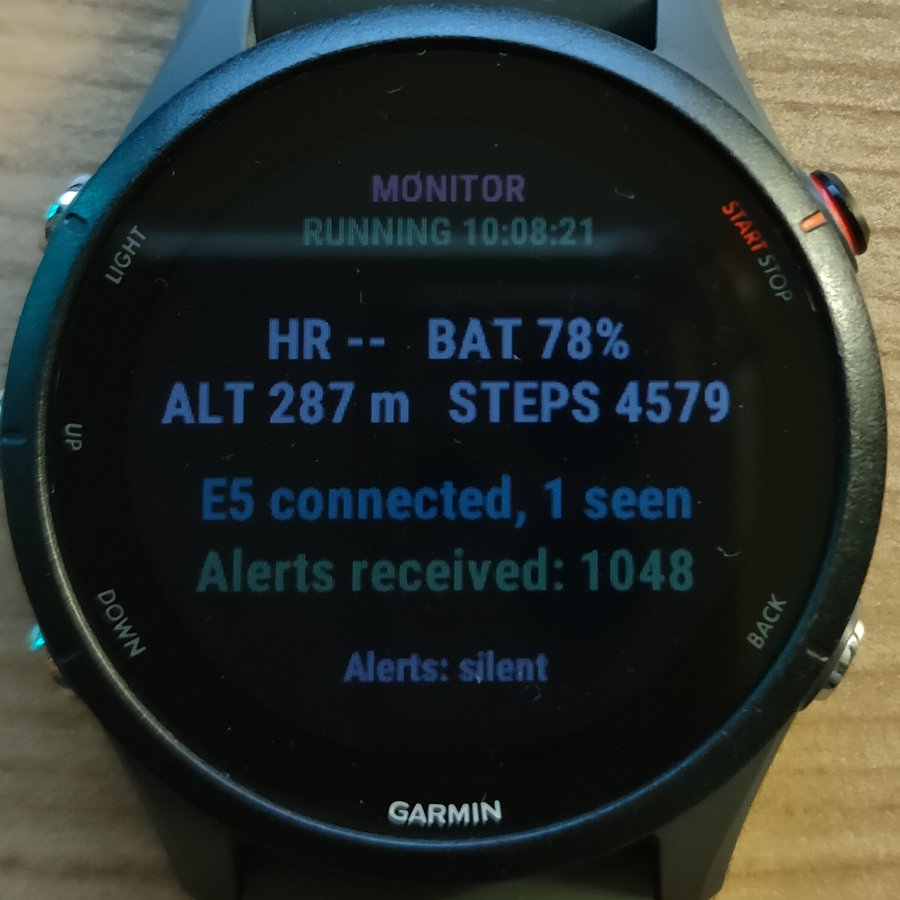
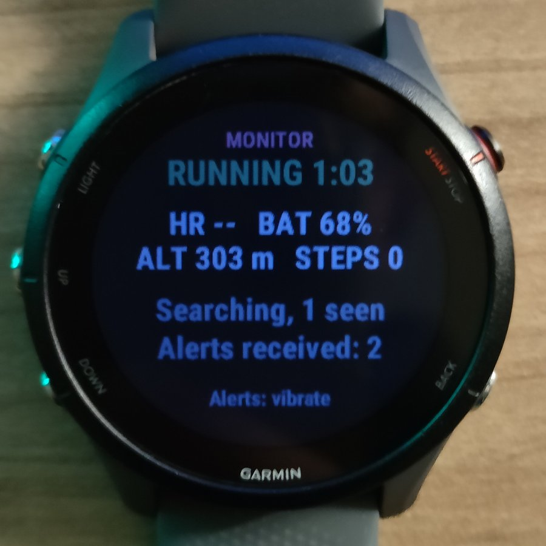
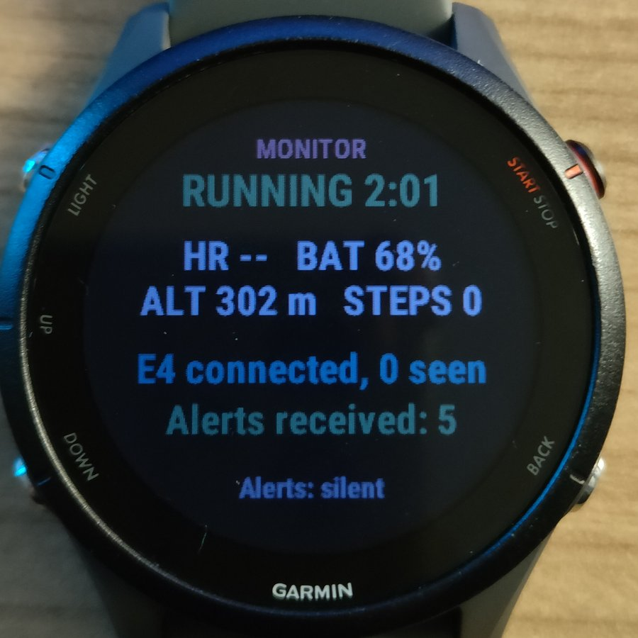
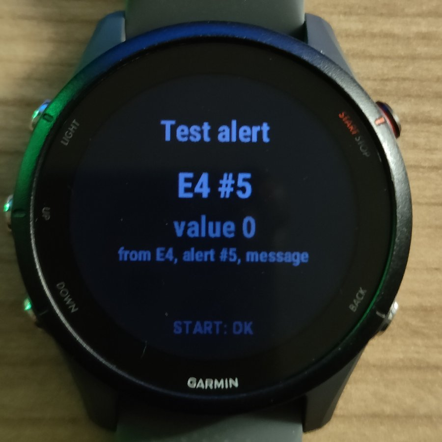

# V5 — Monitoring

> Specification of the **Monitor** (protocol v5) and **single source of truth** of the v5
> format. The Monitor is a device app that uses the same multi-edge radio as the Multi
> variant (v4) and in addition receives alerts from the edges.
>
> **Status**: verified on the FR255 with one edge (with microSD): connection, alert
> subscription, alerts with message, vibration and sound, sending of the 4 values and
> writing to the SD. The app ran a continuous session of more than 10 hours (§ Lifecycle).
> Alerts are not retransmitted: an alert arrives if the watch is connected, otherwise it
> is lost (§ Possible extensions).
>
> The watch side is tested on the device; the format is checked by the Python reference
> (`tools/check_v5.py`) and, on the ESP32, by the C test (`esp32/main/test/test_v5.c`).

## In short

- **Device app** (watch-app) started by hand from the app menu, not a data field.
- The **session is the open app**: it opens at start-up and closes on exit.
- Every 5 s **4 values** are sent: heart rate, battery, steps, altitude.
- The same radio as v4: several edges, choice of the best one and handoff,
  store-and-forward queue, ACK = write response of the last chunk.
- **Alerts**: the connected edge sends an alert to the watch, which shows it as a plain
  message, with vibration or with sound. The watch confirms the reception and, when the
  user presses a key, the reading.

### Design choices

| Topic | Choice |
|---|---|
| Values | HR, battery, steps, altitude |
| Session | the open app: it opens at start-up and closes on exit. Alerts and connection start when the app opens, so no START/STOP command is needed |
| Alert with no watch connected | **it is lost**: the edge sends every alert only once, to the connected and subscribed watch |
| User confirmation | yes: a key on the alert; the confirmation travels to the edge in the data packets |
| Alert sound | a `ToneProfile` built by hand: the FR255 ignores the predefined tones (§ Sound and vibration) |
| Mode on the watch | UP/DOWN picks `as edge` (as the edge asks), `silent`, `sound` or `vibrate`; the last three apply to all alerts (§ Sound and vibration) |
| Data fields and app | they coexist in the same project and on the same edges (§ Build) |

---

## Architecture

```
   ESP32 edge N                                         FR255 — BLE-Monitor (watch-app)
 ┌──────────────────────────┐                        ┌────────────────────────────────────┐
 │ alert timer (simulated)  │   notify ALERT (20 B)  │ MonitorBleDelegate                  │
 │   one notify per alert ──┼──────────────────────► │   → alert queue → vibrate/sound,    │
 │                          │                        │     alert screen, key = OK          │
 │ v5 parser ◄──────────────┼── write DATA ───────── │ MonitorManager (v4 radio)           │
 │   data → monitor_….csv   │   (2 chunks/sample,    │   ← queue ← MonitorSampler          │
 │   ev_ack/ev_user → log   │    confirmations in    │      (1 s Timer, sample every 5 s)  │
 │                          │    the header)         │                                     │
 └──────────────────────────┘                        └────────────────────────────────────┘
        advertising "T4" node_id busy (the same as v4) → edge choice and handoff
```

---

## The app on the watch

| | |
|---|---|
| Type | `watch-app` (manifest), started from the app menu |
| Folders | `variants/monitor/` (jungle, manifest, `VariantConfig.mc`), `source-monitor/` (code), `resources-monitor/` (app name) |
| `Variant.ID` / `NAME` | `6` / `"MONITOR"` |
| App UUID / name | `a1b2c3d4-0006-4f00-9000-00000000f016` / `BLE-Monitor` |
| Permissions | `BluetoothLowEnergy`, `Sensor`. No `FitContributor`: the jungle excludes `FitLogger` and the other data field classes (§ Build) |
| FIT | none: no `ActivityRecording` |

### Lifecycle

| Moment | What happens |
|---|---|
| Opening | new session: `session_id` = epoch of that instant, `seq` from 0. The radio starts (scan and connection to the best edge, like the MULTI), then a sample every 5 s. Alerts arrive as soon as there is an edge |
| Without edges | the samples stay in the queue (1 h) and leave at the next connection |
| BACK | always asks for confirmation (`Stop and exit?`); on exit the session closes and radio, data and alerts stop. The samples still queued are lost |
| Reopening | another session, with another file on the SD |

Time is driven by a 1 s `Timer.Timer`: it reads the 4 values, calls
`MonitorManager.tick()` and every 5 ticks takes a sample. A watch-app has no
`compute()`.

The FR255 keeps the app open for long sessions: in a test it ran for more than
10 hours in a row and received 1048 alerts.

<p align="center">
  
</p>
<p align="center"><sub>
  A continuous session: <code>RUNNING 10:08:21</code>, connected to E5, 1048 alerts
  received, alert mode <code>silent</code>. The watch is lying on a table, so the heart
  rate is <code>--</code>.
</sub></p>

### Keys

| Screen | START | UP / DOWN | BACK |
|---|---|---|---|
| Main | — | previous / next alert mode | exits (with confirmation, see above) |
| Alert | confirms the alert | — | confirms the alert |

### Screens

**Main**, four zones from the top:

```
        MONITOR
     RUNNING 12:34          ← time since the app was opened

    HR 72   BAT 85%         ← the 4 values, nothing else ("--" = missing data)
   ALT 120 m   STEPS 4321

  E2 connected, 3 seen      ← or "Connecting E2, 3 seen" / "Searching, 3 seen"
   Alerts received: 3       ← alerts received in the session

     Alerts: as edge        ← alert mode: UP/DOWN change it
```

- The radio row fits on a single line: state (searching, connecting, connected edge) and
  registered edges seen in the last seconds.
- **Alerts received** counts the new alerts (not the duplicates) since the app was
  opened.
- The **colour** of the alert row tells the state of the subscription to the ALERT
  characteristic: green active, orange in progress or characteristic missing on the
  edge, red failed, grey no edge.
- **Alerts** at the bottom is the alert mode chosen on the watch (§ Sound and
  vibration); BACK exits even though it is not written.

**Alert**: type (`Test alert`, `Info`, `Warning`, `Danger`, each with its colour), text,
value, edge and alert number, the mode executed by the watch, how many others are waiting
for confirmation. If sound or vibration are off in the watch settings, it says so
(`vibration off`, `tones off`).

<table align="center">
  <tr>
    <td align="center"></td>
    <td align="center"></td>
    <td align="center"></td>
  </tr>
  <tr>
    <td align="center"><sub><code>Searching, 1 seen</code>, alert mode <code>vibrate</code></sub></td>
    <td align="center"><sub><code>E4 connected, 0 seen</code>, alert mode <code>silent</code></sub></td>
    <td align="center"><sub>Simulated alert #5 from E4, shown as a message</sub></td>
  </tr>
</table>

<p align="center"><sub>
  In the middle photo the count is <code>0 seen</code> while connected: the watch is not
  receiving the busy advertising of the current edge, the same open point as the frozen
  dBm of the Multi (<a href="protocol.md#known-limitations">protocol.md § Known
  limitations</a>). The heart rate is <code>--</code> because the watch is not worn.
</sub></p>

Every line goes through `MonDraw.text`: if it does not fit in the width of the round
screen at that height, it switches to a smaller font and, if that is not enough, it is
shortened.

### Sound and vibration

- **Vibration**: two 400 ms pulses 200 ms apart (`Attention.vibrate`).
- **Sound**: a `ToneProfile` built by hand, 2500 / 4000 / 2500 Hz, 250 ms each.
  The FR255 **ignores the predefined tones** (`TONE_*`) requested by a device app: with
  tones enabled in the settings, `TONE_ALERT_HI`, `TONE_LOUD_BEEP` and `TONE_ALARM` do
  not play, the `ToneProfile` does. The same behaviour is reported on the Forerunner 165
  ([Connect IQ forum](https://forums.garmin.com/developer/connect-iq/f/discussion/415940/playtone-oddities-on-fr165-device)).
- **Who decides**: every alert carries in its `alert` field the request of the edge
  (message, vibration, sound or both). On the watch UP/DOWN picks the mode, remembered
  from one opening to the next (`Application.Storage`):

  | Mode | What the watch does |
  |---|---|
  | `as edge` (initial) | executes the request of the edge |
  | `silent` | message only, for all alerts |
  | `sound` | sound only, for all alerts |
  | `vibrate` | vibration only, for all alerts |

  In every case the screen turns on and the alert screen waits for the confirmation.
- The watch settings prevail: with tones or vibration off, the alert arrives as a
  message only.

---

## The 4 values

| Field | Source | Encoding (uint16) |
|---|---|---|
| `hr` | `Sensor.Info.heartRate` (sensor events) | bpm |
| `batt` | `System.getSystemStats().battery` | % × 100 (0–10000), as in v3 |
| `steps` | `ActivityMonitor.getInfo().steps` | steps **of the day**, saturated at 65534 |
| `alt` | `Sensor.Info.altitude` (sensor events) | metres + 10000 (the v3 `ALT_OFFSET`), 1 m resolution |

- Missing data (`null`) → sentinel **`0xFFFF`**.
- The values are rounded to the nearest integer and saturated to 0–65534
  (`ProtoV5.encU16`).
- The app turns on the heart rate sensor (`Sensor.setEnabledSensors`).
- The steps are those of the day, so they reset at midnight: they are not the steps of
  the session.
- **Altitude without GPS**: the Monitor does not turn on the GPS, yet
  `Sensor.Info.altitude` has a value: it comes from the barometer (verified on the
  watch). On screen `ALT --` means `null`.

---

## v5 uplink — FR255 → ESP32

Same transport as v3 (20 B chunks, `flags = 11`) and same `0xA5` magic as v4: the
`proto_ver = 0x06` byte tells it apart. Everything is **big-endian**, as in v4.

**Header — 16 bytes** (the first 14 are those of v4)

| Off | Type | Field | Notes |
|---|---|---|---|
| 0 | uint8 | `magic` | `0xA5` |
| 1 | uint8 | `proto_ver` | `0x06` |
| 2 | uint8 | `node_id` | **addressee** edge |
| 3 | uint8 | `n_samples` | 0–8; **0 = alert confirmations only** |
| 4 | uint32 | `session_id` | epoch of the app opening (the session) |
| 8 | uint32 | `seq_first` | seq of the 1st sample; with `n_samples = 0` it is the next seq, to be ignored |
| 12 | uint8 | `backlog` | samples still queued after these (saturates at 255) |
| 13 | uint8 | `conn_no` | number of the connection in the session (mod 256) |
| 14 | uint8 | `ev_ack` | last alert **received** from this edge (cumulative); 0 = none |
| 15 | uint8 | `ev_user` | last alert **confirmed by the user** for this edge (cumulative); 0 = none |

**Sample — 12 bytes**

| Off | Type | Field |
|---|---|---|
| 0 | uint32 | `realTime` (UTC epoch, s) |
| 4 | uint16 | `hr` |
| 6 | uint16 | `batt` |
| 8 | uint16 | `steps` |
| 10 | uint16 | `alt` |

**Trailer** — `uint16` BE, CRC-16/CCITT-FALSE over everything else (the same as v4,
[protocol.md § CRC](protocol.md#crc)).

**Sizes**: `18 + 12·n`.

| `n_samples` | v5 | v4 |
|---|---|---|
| 0 (confirmations only) | 18 B, 2 chunks | — |
| 1 (steady state) | 30 B, 2 chunks | 64 B, 4 chunks |
| 4 | 66 B, 5 chunks | 208 B, 13 chunks |
| 8 (maximum, draining the queue) | 114 B, 8 chunks | — |

The queue drains at about one sample per chunk, against 0.3 for v4.

**Delivery**: as in v4. A packet is confirmed when the ESP32 answers the last chunk with
success, after validating it. Validation, in the same order as v4: minimum length 18,
magic and version, `n ≤ 8`, exact length `18 + 12·n`, CRC. A packet with
`n_samples = 0` is always confirmed, writes no data rows and does not enter the `seq`
continuity: it carries only `ev_ack` and `ev_user`. An edge with SD whose queue towards
the SD is full rejects the packets with samples, as in v4: the watch retransmits them.

**Routing on the ESP32** (`flags = 11`): `0x05` → v4, `0x06` → v5, any other value is
rejected. The same firmware also serves the MULTI.

Queue on the watch: 720 samples (1 h at 5 s), 8,640 B.

---

## Alerts — ESP32 → FR255

A **notification** on the **ALERT** characteristic
(`51FF12BB-3ED8-46E5-B4F9-D64E25E01DBB`, NOTIFY only). **20 bytes**, the maximum:
Connect IQ does not negotiate the MTU.

Only the Monitor subscribes to it: for the edge, "subscribed to ALERT" means "it is a V5
watch", and the data fields (which do not subscribe) never receive alerts.

| Off | Type | Field | Notes |
|---|---|---|---|
| 0 | uint8 | `magic` | `0x5A` |
| 1 | uint8 | `proto_ver` | `0x06` |
| 2 | uint8 | `node_id` | sending edge |
| 3 | uint8 | `ev_seq` | 1–255 per edge, then back to 1; 0 is not used |
| 4 | uint8 | `ev_type` | 0 test, 1 information, 2 warning, 3 danger |
| 5 | uint8 | `alert` | bit0 vibration, bit1 sound; 0 = message only; bits 2–7 at 0 |
| 6 | uint16 | `ev_value` | parameter (BE); `0xFFFF` = none |
| 8 | char[11] | `text` | ASCII, padded with 0; empty = the default text of `ev_type` |
| 19 | uint8 | `crc8` | over bytes 0–18; CRC-8 poly `0x07`, init `0x00` ([protocol.md § CRC](protocol.md#crc)) |

### Subscription

The watch-app registers ALERT with its CCCD and, **at every connection** (also after a
handoff), writes `[0x01, 0x00]` to the CCCD. ATT allows a single operation in flight: no
data chunk leaves before the outcome (`onDescriptorWrite`), or before 6 s without an
outcome expire.

With an edge that lacks the ALERT characteristic the app connects anyway and shows the
alert row in orange.

### On the watch

1. **Validation**: length, magic, version, CRC-8, `ev_seq` other than 0. An invalid alert
   is discarded.
2. **Duplicates**: if `ev_seq` matches the last one received from that `node_id`, no new
   alert.
3. **New alert**:
   - sound and/or vibration according to `alert` and the chosen mode, and the screen
     turns on;
   - the alert enters the **queue of alerts to confirm**, up to 8 (beyond that, the
     oldest leaves);
   - `ev_ack` and `ev_user` travel in the next data packet towards that edge.
4. **Alert screen**: shows the oldest one to confirm. The key confirms it and moves on to
   the next one.

For every edge the watch keeps two numbers: the last alert received and the last one
confirmed. The packets towards an edge carry its two values in `ev_ack` and `ev_user`. A
confirmation given after a handoff therefore reaches that edge when the watch connects
to it again, and is lost if it never does. The confirmations follow the order of
arrival, so the values are **cumulative**: `ev_user = 7` also confirms 6.

Alerts and data travel on the same connection as long as the app is open. With the app
closed nothing arrives, because BLE is not available in the background.

### On the ESP32

- **When it sends**: only with the watch connected **and subscribed to ALERT**
  (`BLE_GAP_EVENT_SUBSCRIBE` event on that characteristic with notifications on, cleared
  on disconnection). With a data field connected nothing is ever sent.
- **Only once**: every alert leaves as soon as it is created, without waiting for
  confirmations and without retransmissions. If the watch is not connected and
  subscribed, the alert is not even created.
- `ev_ack` and `ev_user` received in the data packets are printed on the console.

**Simulated alerts** (next to the board lines in `ble.c`):

```c
#define THIS_EDGE_EVENT_S      30  // how often (seconds) a simulated alert is created; 0 = never
#define THIS_EDGE_EVENT_ALERT  4   // 0 message, 1 vibration, 2 sound, 3 both, 4 rotating
```

- The first alert leaves as soon as the watch subscribes, then one every
  `THIS_EDGE_EVENT_S` seconds as long as it stays subscribed.
- `THIS_EDGE_EVENT_S` must be 0 or at least 20 (checked at build time).
- Simulated alert: `ev_type = 0`, text `E<node> #<ev_seq>`, `ev_value = 0`. With the
  rotation the mode follows `ev_seq`: #1 message, #2 vibration, #3 sound, #4 both, then
  from the start again.

### Possible extensions

The format already provides what a reliable delivery of the alerts would need, which
today is **not implemented**:

- on the edge, an alert queue with an expiry (for example 2 minutes), from which the
  oldest is sent and retransmitted until the watch confirms it with `ev_ack`;
- on the watch, a confirmations-only packet (`n_samples = 0`) sent as soon as an alert
  arrives, without waiting for the next sample;
- on SD, an alert file with creation, sends, reception confirmation (`ev_ack`) and user
  confirmation (`ev_user`), from which latency and delivery rate can be derived.

### SD recording (edges with microSD)

`/monitor_<session>_n<node>.csv` — one row per received sample (append, as in v4):

```
rx_ms,node,session,seq,conn_no,backlog,dup,realTime,hr,batt,steps,alt
```

`batt` in % with two decimals, `alt` in metres (offset removed), `N/A` for the sentinels.

The events of the v5 data (`session`, `jump`, `dup`, `reject`, `node_mismatch`,
`queue_full`) go into the event file of the edge, `edge_n<node>_events.csv`, with the
same names as v4: the session tells them apart.

On the console, one line per packet with the values of the last sample:

```
v5 S=1790000000 seq=0+1 backlog=0 conn=1 hr=142 batt=87.00% steps=5230 alt=123m ev_ack=0 ev_user=0
```

### Rebuilding the session from the SD cards

Every edge writes only the samples received while the watch was connected to it.
`tools/merge_multi.py` rebuilds the whole session from the cards of all the edges with
SD, as for v4: it recognises the v5 files by their name (`monitor_…`) and handles them
separately from the Multi ones.

```powershell
python tools/merge_multi.py sd --out session.csv     # sd\e1, sd\e2, … = the copied cards
```

- **Merging and duplicates**: the files are merged by session and the samples are
  deduplicated by `seq`; two copies of the same `seq` with different values are a
  conflict (exit code 3).
- **Gaps**, classified with `conn_no`: if a connection number is missing between the
  samples before and after the gap, those samples went to an edge **without SD**
  (accepted loss); otherwise they are really **lost** (exit code 2).
- **Left on the watch**: the `backlog` of the last packet, i.e. the samples still queued
  when the app was closed.
- **Edge sequence**: who received what, in `seq` order, with the watch time
  (`realTime`), and the summary of the events of each edge.
- **Session values**: duration, minimum, mean and maximum heart rate, battery drop
  (points and %/h), steps taken in the session, minimum and maximum altitude, and how
  many samples lacked the value. The steps are counted by summing the increments of the
  daily counter, so a gap takes nothing away and the midnight reset counts as a restart
  from 0.

Neither the radio (v5 does not have the v4 telemetry: only the connections and
disconnections of the edges with SD remain, in the event files) nor the alerts, which do
not end up on the SD, are rebuilt.

---

## Code

| | File |
|---|---|
| From `source/`, as they are | `Chunker`, `ProtocolV3` (transport, CRC-16, CRC-8), `ProtocolV4` (advertising), `EdgeRadar`, `MultiState`, `Cfg` (radio `MULTI_*` parameters) |
| Derived from the Multi, in `source-monitor/` | `MonitorManager` (structure of `MultiManager`): MULTI delivery and handoff, plus the ALERT subscription and the v5 packet with `ev_ack`/`ev_user`; no chunk before the outcome of the CCCD write. `MonitorBleDelegate` (like `MultiBleDelegate`): plus `onDescriptorWrite` and `onCharacteristicChanged`. `MonRing` (like `SampleRing`): the queue of 12 B samples |
| Specific to the Monitor, in `source-monitor/` | `MonitorApp` (Timer, session, sensors, sound and vibration), `MonitorView`, `MonitorDelegate`, `AlertView` with `AlertText` and the delegate, `AlertQueue`, `MonitorSampler`, `ProtocolV5`, `MonDraw`, `MonCfg` |
| `resources-monitor/` | app name. The on-screen texts are in the code, as in the other variants |
| Tools | `tools/check_v5.py`: Python reference of the format and vectors for the ESP32 C test. `tools/merge_multi.py`: rebuilding the session from the SD cards, for v4 and v5 |

**ESP32 side**:
- the ALERT characteristic with the subscription flag and the sending of the simulated
  alerts (`ble.c`, alert builder in `protocol_v5.h`);
- the routing of `0x06`, the v5 parser with the per-node continuity (`monitor.c`) and
  `monitor_…csv` (`monitor_log.c`);
- `test_v5.c` tests the real parser against `v5_vectors.h` and every single-bit
  corruption.

---

## Build

```
source/             shared code: data fields and Monitor
resources/          shared resources
variants/<name>/    jungle, manifest and VariantConfig of every build
source-monitor/     Monitor code
resources-monitor/  Monitor strings
```

The Monitor jungle adds its own folders to the shared ones, and excludes what only the
data fields need:

```
project.manifest           = manifest-monitor.xml
base.sourcePath            = ../../source;../../source-monitor;.
base.resourcePath          = ../../resources/drawables;../../resources-monitor
base.excludeAnnotations    = datafield
```

- `excludeAnnotations = datafield` removes from the build the parts of `source/`
  annotated `(:datafield)`, i.e. everything only the data fields need: `DataFieldApp`,
  `V3DfView`, `MultiDfView`, `FitLogger`, the v3 radio (`BleManager`, `MyBleDelegate`)
  and the v4 one (`MultiManager`, `MultiBleDelegate`), `Sampler`, `Encoders`,
  `SampleRing` and `Colors`. What remains is `Chunker`, `ProtoV3`, `ProtoV4`,
  `EdgeRadar`, `MultiState` and `Cfg`. Without `FitLogger` the Monitor does not use
  `FitContributor`, and the manifest does not ask for that permission; the `.prg` is a
  little lighter than the data field ones (about 133 kB against 135 kB).
- From `resources/` only the icon is needed (`drawables/`): the strings are the names of
  the data fields and the labels of the FIT fields, `fit/` holds the metadata of those
  fields.
- A new class or module of `source/` that only the data fields need should be annotated
  `(:datafield)`; one that uses `FitContributor` **must** be, otherwise the Monitor does
  not build (permission error on the lines that use `FitContributor`). Conversely, if the
  Monitor starts using an annotated part, the annotation must be removed, otherwise the
  Monitor does not build.

**Build and load**: *Build* task → `monitor` (`Ctrl+Shift+B`), then `bin\monitor.prg`
into `GARMIN\APPS\` over USB, then **BLE-Monitor** from the app list. For the log,
create the empty file `GARMIN\APPS\LOGS\MONITOR.TXT`: `MonitorManager` writes into it
connections, edge changes and subscription, and every 10 s a line with state, alert
subscription (`alerts=`), confirmed chunks and samples (`chunks=`, `samples=`), queue
(`queue=`), dropped samples (`dropped=`), `seq`, connections and
`ho=<intended changes>/<lost links>`.

**Data fields and app together**: they have different UUIDs, so their `.prg` files sit
together in `GARMIN\APPS\`. The data field is used in an activity, the Monitor is opened
from the menu; they never run together. Both unpair at start-up any edge left paired. The
edges have a single firmware for everything: moving from one test to another needs no
reflashing.

---

## Verification on the watch

With a board **with microSD**, pass-by simulation off (`THIS_EDGE_OFF_S 0`), alerts
every 30 s rotating and `idf.py monitor` open:

1. load `bin\monitor.prg` and open the app: "RUNNING 0:00" appears and the time runs;
2. within a few seconds the radio row goes from "Searching" to "E<n> connected", and the
   "Alerts received" row turns green (subscription active); the alerts arrive with
   message, vibration and sound in rotation;
3. every 5 s the monitor of the edge prints a line `v5 S=<session> seq=…`;
4. after a few minutes exit (BACK, confirm) and read the SD: in
   `monitor_<session>_n<node>.csv` the `seq` values are contiguous from 0, and HR,
   battery, altitude and steps are those seen on screen.
   `python tools/merge_multi.py <folder>` must report `LOST (no edge)` 0;
5. queue: reopen the app, switch the edge off (or move away) for a minute and switch it
   back on: the accumulated samples arrive 8 per packet and no `seq` is missing in the
   file.

All the edges the watch can see must have the same firmware: an edge that does not
recognise `proto_ver 0x06` rejects the packets, the watch leaves it after 3 rejections and
connects to it again, in a loop.

---

## Open points

- **Restart of an edge**: `ev_seq` restarts from 1. An alert with the same number as the
  last one received before the restart would be taken for a duplicate. Accepted limit.
- **Consumption**: a foreground app with the screen on is not comparable with the v4
  data field inside an activity with GPS.

The lifecycle point is closed: the FR255 kept the watch-app open for a continuous session
of more than 10 hours (§ Lifecycle).
