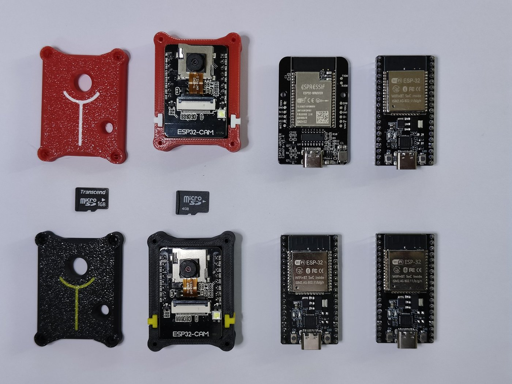
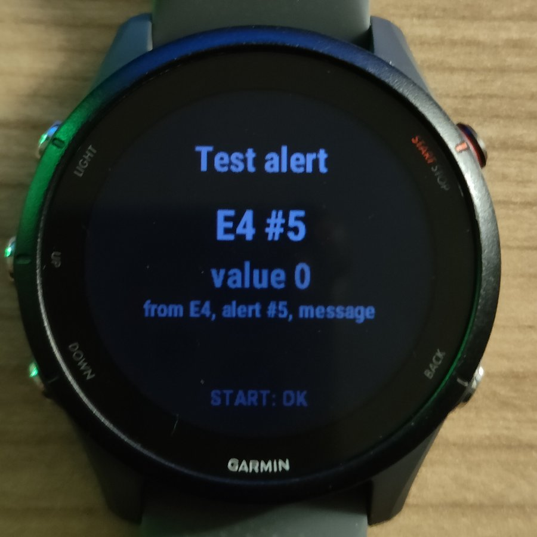

# ESP32-CAM — BLE GATT Peripheral (v3 + v4 + v5) + SD logging (ESP-IDF v5.5, NimBLE)

Firmware of the ESP32 side. It receives the data of the **four data field variants** and
of the **Monitor** watch-app, and logs them to microSD; for v4 and v5 it acts as an
**edge**, one of several ESP32 boards placed along the path.

<p align="center">
  
</p>
<p align="center"><sub>
  The fleet of § Several edges: two ESP32-CAM AI-Thinker boards with microSD in
  3D-printed cases (nodes 1–2), an ESP32-WROVER camera board without microSD (node 3)
  and three ESP32 development boards (nodes 4–6).
</sub></p>

| Protocol | Variant | What the ESP32 does | On SD |
|---|---|---|---|
| **v3** | Full / Delta / Batch | reassembles, validates, prints CSV on the console. One-way | `activity_N.csv` |
| **v4** | Multi | **confirms** every packet (ACK), recognises duplicates and jumps; the watch connects to the edge with the best signal | `multi_<session>_n<node>.csv` + `edge_n<node>_events.csv` |
| **v5** | Monitor (watch-app) | like v4 for the data (4 values: HR, battery, steps, altitude); sends simulated **alerts** to the watch via NOTIFY. The alert confirmations are read and printed | `monitor_<session>_n<node>.csv` + `edge_n<node>_events.csv` |

**A single source serves them all**: the protocols are told apart by the `flags` code
point of the transport header (`0b11` = application payload, then `proto_ver` picks v4
or v5), not by a build flag. The **only** differences between the firmware of the
various ESP32 boards are a few adjacent lines in `src/ble.c` (see § Several edges). The
v3 variants find the device by Service UUID, v4 and v5 by Manufacturer Specific Data.

The **full specification** of the protocols (header bits, format layouts, costs,
integrity checks, v4) is in [`docs/protocol.md`](../docs/protocol.md), the V5 one in
[`docs/v5_monitoring.md`](../docs/v5_monitoring.md). The tables are reproduced as
comments in the `main/include/protocol_v*.h` headers, mirrors of the watch files
`source/ProtocolV3.mc`, `source/ProtocolV4.mc` and `source-monitor/ProtocolV5.mc`.

## GATT and advertising

| Characteristic | UUID | Use |
|---|---|---|
| Service | `A07498CA-AD5B-474E-940D-16F1F14E8972` | peripheral recognition (v3) |
| DATA | `51FF12BB-...DB5` | Write — receives the chunks of **all** the protocols (v3, v4, v5) |
| ALERT | `51FF12BB-...DBB` | Notify — v5 alerts (20 B): CCCD generated by NimBLE |

Only the Monitor watch-app subscribes to ALERT: until someone writes the CCCD the edge
sends no alerts, so the v3 and v4 data fields are not affected.

**Advertising**: Service UUID and **Manufacturer Specific Data** (company `0xFFFF`,
`54 34 <node_id> <flags>`) in the main packet, 29 bytes out of 31; the name
`EDGE-<node_id>` in the scan response. **While connected the edge keeps advertising**,
non-connectable and with the busy bit at 1: this way the watch measures its RSSI and
decides the handoff. On disconnection the advertising becomes connectable again.

## Firmware architecture

Two tasks on different cores, linked by FreeRTOS queues: the radio never waits for the
SD.

```
 core 0 — NimBLE host task                                  core 1 — sd_logger, every 5 s
 write DATA → chr_access → on_chunk → packet_complete ─┬ v3 → s_sample_q (32) ─┐
              (reassembles by     (checks, parser)     ├ v4 → s_multi_q  (16) ─┤
               pktId)                                  └ v5 → s_mon_q    (16) ─┼→ drain → microSD
 connect / disconnect / rejects / v4 and v5 duplicates ────→ s_mev_q     (24) ─┘
 ALERT subscription → alert_tick every EVENT_S → notify ALERT   (v5 alerts, no SD)
```

- `main.c` initialises NVS, then `ble_init()` (creates the queues, starts NimBLE and the
  advertising) and `sd_logger_start()` (task pinned to core 1).
- The BLE task queues with a 0 timeout: it never blocks. The SD is touched **only** from
  core 1, so a slow FAT write or a remount after a hot-plug never delays the radio.
- At every round the SD task drains, in order: events, v4 data, v5 data, v3 samples.
  The events come before the data, so in `edge_n<node>_events.csv` a connection appears
  before the samples it carried.
- Logging **does not depend on the link state**: whatever is queued gets written. The
  watch transmits only with the timer running, so empty queue = no rows.

| Queue | Slots | Content | When it is full |
|---|---|---|---|
| `s_sample_q` | 32 (`SAMPLE_QUEUE_LEN`, `ble.c`) | a rebuilt v3 sample | sample lost (warning); the watch does not know |
| `s_multi_q` | 16 (`MULTI_QUEUE_LEN`, `config.h`) | accepted v4 packet (boards with SD only) | packet **rejected** with an ATT error: the watch retransmits it |
| `s_mon_q` | 16 (`MONITOR_QUEUE_LEN`, `config.h`) | accepted v5 packet with at least one sample (boards with SD only) | as for v4: packet **rejected** |
| `s_mev_q` | 24 (`MULTI_EVENT_QUEUE_LEN`, `config.h`) | event for `edge_n<node>_events.csv` (v4 and v5) | event lost (warning `event queue full`); the data are not affected |

### Routing and write outcome: the v4 and v5 ACK

For `flags = 11` (APP) the `proto_ver` byte (offset 1, same `0xA5` magic) picks the
parser: **`0x06` → v5**, any other value → **v4**, which accepts only `0x05` and rejects
the rest with reason `magic`. This way an unknown version gets an error instead of being
confirmed and lost.

NimBLE sends the write response **after** the access callback has returned: the outcome
can therefore reflect the validation of the whole packet.

| `flags` | malformed chunk | last chunk, valid packet | last chunk, packet dropped or incomplete |
|---|---|---|---|
| `00` / `01` / `10` (v3) | 0 | 0 | 0 — always success |
| `11`, v4 (`0x05`) | error | 0 = **ACK** | error: the watch retransmits |
| `11`, v5 (`0x06`) | error | 0 = **ACK** | error: the watch retransmits |
| `11`, other version | error | — | error (`reject` event, reason `magic`) |

Error = `BLE_ATT_ERR_UNLIKELY`. On the boards with SD a valid packet that finds no room
in its queue (`s_multi_q` for v4, `s_mon_q` for v5) is rejected too; without SD a valid
packet is always confirmed. Duplicates are always confirmed: they are already here. A v5
confirmations-only packet (`n_samples = 0`) does not go through the queue and is always
confirmed.

v5 validation (`monitor.c`), in order: minimum length 18 B, magic `0xA5` and version
`0x06`, `n_samples` ≤ 8, exact length `18 + 12·n`, CRC-16. The rejects end up in the
events as `reject`, with the same codes as v4 (1 `len`, 2 `magic`, 3 `n_samples`,
4 `crc`).

### Console output

At INFO level (the default) one line for every unit received or sent:

- **v3** — one CSV row per sample:
  `realTime,elapsed,hr,cad,speed,dist,alt,ascent,kcal,heading,timer,watchBatt,fmt`
  (`N/A` = missing data);
- **v4** — `v4 S=<session> seq=<first>+<n> backlog=<backlog> conn=<n> hr=… radio=…
  rssi=… t_conn=<s>s`, with `[DUP]` or `[JUMP]`. `radio` (`ricerca` = searching /
  `aggancio` = pairing / `connesso` = connected, the names used in the existing data and
  logs), `rssi` and `t_conn` come from the telemetry of the last sample;
  `v4 DROPPED (<reason>, <n> B): the watch will send it again` or
  `rejected: SD queue full` when the watch will have to retransmit (a `proto_ver` other
  than 0x05 and 0x06 also ends up here, with reason `magic`);
- **v5**, data — `v5 S=<session> seq=<first>+<n> backlog=<backlog> conn=<n> hr=…
  batt=…% steps=… alt=…m ev_ack=… ev_user=…`, with `[DUP]` or `[JUMP]`. The values are
  those of the last sample (`N/A` = missing data, without unit); for a
  confirmations-only packet `v5 confirmations ev_ack=… ev_user=…`.
  `v5 DROPPED (<reason>, <n> B)` or `rejected: SD queue full` when the watch will have
  to retransmit;
- **v5**, alerts — `V5 alerts ENABLED by the watch` on subscription, then
  `ALERT #<n> (<mode>) 'E<node> #<n>' sent` for every alert (`NOT sent: notify rc=…` if
  the notification fails) and `V5 alerts disabled (end of connection)`.

The **DEBUG** logs (tags `PROTO`, `MULTI`, `MONITOR`) report every chunk, the reason of
every reject and the **counts per format with the average popcount of the DELTA
bitmasks**. With the project configuration they are **not compiled**
(`CONFIG_LOG_MAXIMUM_LEVEL` = Info). To get them: `idf.py menuconfig` → *Component
config → Log* → default level and maximum level to **Debug**. `menuconfig` changes the
local `sdkconfig`, which is not versioned: the shared configuration stays the one in
`sdkconfig.defaults`. Do not leave them on during measurements: every chunk produces a
line printed inside the GATT callback.

## Layout
```
esp32/
├── CMakeLists.txt              # ESP-IDF project
├── sdkconfig.defaults          # NimBLE, BLE-only, console, FATFS (512 B sectors, LFN);
│                               # ESP-IDF generates sdkconfig from it (not versioned)
├── main/
│   ├── CMakeLists.txt          # sources + REQUIRES + -Wdouble-promotion
│   ├── main.c                  # entry point: NVS + ble_init() + sd_logger_start()
│   ├── include/
│   │   ├── config.h            # parameters: SD paths, periods, core of the SD task, v4/v5 queues
│   │   ├── ble.h               # BLE module interface (popping from the four queues)
│   │   ├── sd.h                # SD module interface (+ append open and fsync)
│   │   ├── protocol_v3.h       # v3: transport, FULL/DELTA/BATCH formats, CRC  ⇄ ProtocolV3.mc
│   │   ├── protocol_v4.h       # v4: offsets, telemetry, advertising  ⇄ ProtocolV4.mc
│   │   ├── protocol_v5.h       # v5: alert, routing, uplink offsets  ⇄ ProtocolV5.mc
│   │   ├── multi.h             # v4: parsed packet, per-node continuity
│   │   ├── multi_log.h         # v4: data file + edge events on SD
│   │   ├── monitor.h           # v5: parsed packet, per-node continuity, text values
│   │   └── monitor_log.h       # v5: data file on SD
│   ├── src/
│   │   ├── ble.c               # ⭐ BOARD CONFIGURATION (node ID, SD, simulation, alerts)
│   │   │                       #    + GATT server, reassembly, v4/v5 ACK, advertising, v5 alerts
│   │   ├── sd.c                # mount + logging task (drains the v3/v4/v5 queues)
│   │   ├── multi.c             # v4: parsing, validation, duplicates/jumps
│   │   ├── multi_log.c         # v4: multi_<session>_n<node>.csv + edge_n<node>_events.csv
│   │   ├── monitor.c           # v5: parsing, validation, duplicates/jumps
│   │   └── monitor_log.c       # v5: monitor_<session>_n<node>.csv
│   └── test/                   # host tests (gcc): test_header.c, test_v4.c, test_v5.c,
│                               # vectors generated by tools/check_*.py, stub/esp_log.h
├── build/                      # build folder (ignored by git)
└── README.md                   # this file
```

The architecture is **modular**: `main.c` only initialises NVS and starts the two modules
(`ble` and `sd`); the real logic is in `src/`, the interfaces in `include/`, the tunable
parameters in `config.h`.

## Prerequisites
- ESP-IDF **v5.5** installed and active (`. $IDF_PATH/export.sh` or ESP-IDF PowerShell)
- One of the boards of the fleet (see § Several edges) and a USB cable: they are all
  flashed over USB
- A **FAT32**-formatted microSD for logging. Boards without a slot are configured with
  `THIS_EDGE_HAS_SD 0` (see § Several edges): they work as edges, but the data stay on
  the console only

## Build / Flash / Monitor
```bash
idf.py set-target esp32          # the ESP32-CAM carries a classic ESP32
idf.py build
idf.py -p <PORT> flash monitor   # e.g. -p COM5  or  -p /dev/ttyUSB0
```

The built firmware is the one of the board configured in `src/ble.c` (see below).

## Several edges (protocols v4 and v5) — one firmware, a few lines per board

The source is **identical** for all the ESP32 boards. The only differences are
**adjacent lines** in [`main/src/ble.c`](main/src/ble.c): the first two say which board it
is, the others how it behaves in the test.

```c
#define THIS_EDGE_NODE_ID  1
#define THIS_EDGE_HAS_SD   1
#define THIS_EDGE_ON_S     10
#define THIS_EDGE_OFF_S    0
#define THIS_EDGE_EVENT_S      30
#define THIS_EDGE_EVENT_ALERT  4
```

- **`THIS_EDGE_NODE_ID`** (1–254) ends up in the advertising, in the BLE name
  (`EDGE-<id>`), in the names of the files on SD and in the text of the alerts.
- **`THIS_EDGE_HAS_SD`**: `1` if the board has the microSD slot, `0` if it does not.
  With `0` the mount is never attempted (GPIOs 2, 14 and 15 stay untouched), and valid
  v4 and v5 packets are confirmed to the watch and then discarded: of the data only the
  `v4 …` and `v5 …` lines remain on the console (see § SD logging, v4).
- **`THIS_EDGE_ON_S` / `THIS_EDGE_OFF_S`**: pass-by simulation of the watch, seconds in
  which the edge is visible and then invisible, in a continuous loop. `OFF_S 0` turns it
  off (edge always visible). See § Pass-by simulation.
- **`THIS_EDGE_EVENT_S` / `THIS_EDGE_EVENT_ALERT`**: simulated V5 alerts towards the
  Monitor watch-app. `EVENT_S` = seconds between one alert and the next (`0` = no alerts,
  otherwise at least 20); `EVENT_ALERT` = how it appears on the watch: `0` message only,
  `1` vibration, `2` sound, `3` both, `4` rotating. See § V5 alerts.

Example fleet, with six boards:

| Board | `THIS_EDGE_NODE_ID` | `THIS_EDGE_HAS_SD` |
|---|:---:|:---:|
| ESP32-CAM AI-Thinker | 1 | 1 |
| ESP32-CAM AI-Thinker | 2 | 1 |
| ESP32-CAM with ESP32-WROVER module, microSD slot not fitted | 3 | 0 |
| ESP32-WROVER | 4 | 0 |
| ESP32-WROVER | 5 | 0 |
| ESP32-WROVER | 6 | 0 |

They all carry a classic ESP32: same target (`esp32`), same configuration
(`sdkconfig.defaults`). The PSRAM of the WROVER modules is disabled and not used. They
are all flashed over USB, with no jumpers. To flash several boards, one at a time:

1. set ID and SD according to the table, simulation and alerts according to the test;
   save;
2. connect the board over USB;
3. `idf.py -p <PORT> flash monitor` — `flash` rebuilds by itself only what changed;
4. at boot check the line that sums up the whole configuration, for example
   `edge node 3 ('EDGE-3'), SD ABSENT (data on the console only), SIMULATION on 10 s / off 120 s, V5 alerts every 30 s (rotating), protocols v3/v4/v5`
   (or `SD present`, `always on`, `V5 alerts disabled`);
5. **label** the board **physically** with its number, then move on to the next one.

- **The watch sees two boards with the same ID as a single edge**: same `node_id` in the
  advertising, and the handoff between them never fires. If a packet arrives addressed to
  another node, the edge accepts it anyway but records `node_mismatch` among the events:
  it is almost certainly a flashing mistake.
- `_Static_assert`s reject at build time an ID outside 1–254, a `THIS_EDGE_HAS_SD`
  value other than 0 or 1, simulation times outside 1–86400 s (`ON_S`) or 0–86400 s
  (`OFF_S`), an `EVENT_S` other than 0 and outside 20–86400 s and an `EVENT_ALERT`
  outside 0–4.
- **The watch accepts the IDs from 1 to 10** (`MULTI_NODE_MIN`..`MULTI_NODE_MAX` in
  `source/Config.mc`): a new edge up to 10 is added by flashing the ESP32 only. Beyond
  that, the range on the watch must be widened.
- **RSSI is not comparable across different models**: different antennas and circuits
  give different values at the same distance, and the handoff (8 dB hysteresis) will tend
  to prefer the board with the better antenna. For measurements it is advisable to note
  the RSSI of every board at a known distance.
- Before a commit it is convenient to put the first four lines back to the reference
  values, `1` / `1` / `10` / `0` (node 1, with SD, simulation off), so the repository
  does not change with every flashed board. The alerts can stay on: they only go to the
  Monitor.

### Pass-by simulation

In the field the runner enters the range of an edge for a few seconds and then moves
away. On the bench the watch stays still next to the edges, so it is the **edge** that
disappears: it stays **on** (visible and connectable) for `THIS_EDGE_ON_S` seconds, then
**off** (invisible) for `THIS_EDGE_OFF_S` seconds, and starts over. For example
`10` / `120` reproduces a 10 s pass every 2 minutes. The values are chosen for the test,
not computed from a real speed.

- **"Off" is not a reset.** Only the radio stops: the advertising is interrupted and a
  connection in progress is closed by the edge. SD, `seq` continuity, uptime and open
  files go on. The cycle starts **on** at boot.
- **What the watch sees**: an immediate disconnection. In the field it would instead see
  a supervision timeout a few seconds later: the simulation slightly anticipates the
  moment it notices it has lost the edge. A packet half way through, or confirmed but
  whose response has not left yet, is retransmitted to the next edge, or here as a
  duplicate (`dup=1`), as it would happen for real.
- **What stays written**: on the console `SIM: edge OFF for N s (invisible)` /
  `SIM: edge ON for N s (visible)`; in the edge events `sim_off` / `sim_on` (column
  `a` = duration of the phase) and then the `disconnect` with reason **`0x216`** (closed
  by this edge), distinct from `0x213` (watch) and `0x208` (link lost).
- **The useful window is shorter than `ON_S`.** After the first sighting the watch waits
  1.5 s to compare the edges, then connects. In the rest of the window it must drain the
  accumulated queue: with `OFF_S` 120 that is 24 samples, i.e. 6 packets of 13 chunks.
  If they do not fit, the queue on the watch grows from cycle to cycle: it is a result to
  measure (`backlog` column, `queue` on screen), not an error.
- **Every board counts from its own boot**: with several edges in simulation the windows
  are not synchronised and depend on when they are switched on.
- It applies to the whole edge, therefore also to the v3 variants and to the Monitor:
  while off no alert leaves.

### V5 alerts

Simulated V5 alerts (specification in [`docs/v5_monitoring.md`](../docs/v5_monitoring.md)):

- the first alert leaves **as soon as the watch subscribes to ALERT**, then one every
  `THIS_EDGE_EVENT_S` seconds as long as it stays subscribed. The disconnection closes
  the subscription and stops the cycle; at the next connection it starts over;
- every alert is a 20-byte notification (`v5_build_alert()` in `protocol_v5.h`):
  `ev_type` 0 (test), `ev_value` 0, text `E<node> #<n>`, `ev_seq` from 1 to 255 and then
  1 again, never 0. With `EVENT_ALERT 4` the mode rotates with the alert number:
  #1 message, #2 vibration, #3 sound, #4 both, #5 message again…;
- every alert leaves **only once**, without waiting for a confirmation: it arrives if the
  watch is connected and subscribed, otherwise it is not even created. There is no
  retransmission;
- the confirmations of the watch, `ev_ack` (last alert received) and `ev_user` (last one
  confirmed by the user), arrive in the header of every v5 packet, including the
  confirmations-only ones. The edge reads and prints them on the console, without using
  them.

<p align="center">
  
</p>
<p align="center"><sub>
  Simulated alert #5 of edge 4 on the watch: <code>ev_type</code> 0 (Test alert), text
  <code>E4 #5</code>, <code>ev_value</code> 0; with rotation, #5 is a message again.
</sub></p>

## Flashing an ESP32-CAM with a USB-TTL adapter
The boards of the fleet are flashed over USB. Only if an ESP32-CAM AI-Thinker has to be
flashed through a USB-TTL adapter (on its own the board has no auto-programming circuit):
1. Connect the USB-TTL: `5V→5V`, `GND→GND`, `U0T→RX`, `U0R→TX`.
2. **Jumper `GPIO0` to `GND`** to enter download mode.
3. Press reset (or power-cycle).
4. Run `idf.py -p <PORT> flash`.
5. Remove the `GPIO0`–`GND` jumper and press reset to start the firmware.
6. `idf.py -p <PORT> monitor` to see the data on the console.

## SD logging

The layouts coexist on the same card: `activity_N.csv` for v3, `multi_*.csv` for v4,
`monitor_*.csv` for v5. v4 and v5 share `edge_n<node>_events.csv`, the event file of the
edge.

**Mounting and hot-plug.** The task tries the mount at start-up and then, if the card is
missing, at every piece of data to write: the SD can be **hot-plugged**. A write error
(card removed) unmounts the SD and the next round tries again. Without SD the firmware
keeps working and the data stay on the console only. On the boards configured with
`THIS_EDGE_HAS_SD 0` the mount is never attempted: the task drains the queues and
discards the data.

> The `max_files` of the mount is **8**. In the worst case 4 files are open together: the
> two of v4, the v5 data file and the v3 CSV during the round. The value is the one tested
> in the field and leaves a margin.

### v4 (MULTI variant) — one file per session and per node

```
/multi_<session>_n<node>.csv   rx_ms,node,session,seq,conn_no,backlog,dup,realTime,…,watchBatt
/edge_n<node>_events.csv       uptime_ms,event,session,a,b
```

- The data file is chosen by the **`session_id` written by the watch**, the same on all
  the edges: no "inactivity" sessions. Name with session and node, so the cards of
  several edges can be copied into the same folder without collisions.
- **Append**, not overwrite: a restart in the middle of a session loses no rows.
  `fflush` + `fsync` at every round in which something was written.
- `dup=1` = sample already received by **this** edge (write response lost,
  retransmitted). Duplicate rows are written: they are the measure of the
  retransmissions.
- `rx_ms` is the uptime of the edge: it is not comparable across edges. The common clock
  is the watch `realTime`.
- Sample columns: `hr,cad,speed,dist`, then the **radio telemetry** of the watch
  (fields 4–7, `proto_ver` 0x05) already split,
  `t_conn_s,t_scan_s,t_agg_s,tx_chunks,n_try,n_conn,n_ho,n_lost,n_fail,radio,scan_on,roam_ok,rssi,coda`,
  then `timer,watchBatt`. The counters are cumulative since the start and read at the
  same instant as the battery: between any two rows of the same file (even just the
  first and the last) the difference tells what the radio did in between. Meaning and
  moduli in `main/include/protocol_v4.h` and in
  [`docs/protocol.md`](../docs/protocol.md).
- Events: `boot`, `connect`, `disconnect` (HCI reason in hex: `0x213` closed by the
  watch, `0x208` link lost, `0x216` closed by the edge in simulation), `session`, `jump`,
  `dup`, `reject`, `node_mismatch`, `queue_full`, `sim_off`, `sim_on`. Meaning of the
  `a`/`b` columns in `main/include/multi_log.h`.
- **Full SD queue → the packet is REJECTED** with an ATT error: the watch keeps it and
  retransmits it, instead of seeing it confirmed and then lost here.
- **Without SD the packet is confirmed anyway**, whether the board has no slot
  (`THIS_EDGE_HAS_SD 0`) or the microSD is missing. Rejecting it would make the watch
  spin in vain: after 3 rejected packets it abandons the edge. The data stay on the
  console only.
- **For the system those samples are lost**, not just unrecorded: once confirmed, the
  watch removes them from its queue and no other edge will receive them. The edge
  without SD produces neither data files nor event files, but `merge_multi.py`
  recognises those gaps from the connection number (`conn_no`) that appears in no file
  and reports them as **"to edges without files"**, separately from the **LOST** ones
  and without changing the exit code (see [`docs/protocol.md`](../docs/protocol.md),
  § Merging).
- Merging the files of all the edges: `python tools/merge_multi.py <folder>`
  (see [`docs/protocol.md`](../docs/protocol.md), § Merging).

### v5 (Monitor) — one file per session and per node

```
/monitor_<session>_n<node>.csv   rx_ms,node,session,seq,conn_no,backlog,dup,realTime,hr,batt,steps,alt
```

- Same rules as v4: file chosen by the `session_id` of the watch, name with session and
  node, append, `fflush` + `fsync` at every round, `dup=1` for the samples already
  received by this edge, full queue → packet rejected, without SD → confirmed and lost.
- Values: `hr` in bpm, `batt` in % with two decimals, `steps` steps of the day, `alt` in
  metres (offset removed); `N/A` = missing data. `realTime` is the UTC epoch of the
  watch.
- A **confirmations-only** packet (`n_samples = 0`) writes no rows and does not enter the
  `seq` continuity. `ev_ack` and `ev_user` stay on the console.
- The events (`session`, `jump`, `dup`, `reject`, `node_mismatch`, `queue_full`) go into
  `edge_n<node>_events.csv` like the v4 ones; the session tells them apart. The
  connections carry the session of the last accepted packet, v4 or v5. The `seq`
  continuity has a state separate from the v4 one.

### v3 (Full / Delta / Batch) — one file per activity

- **One row per received sample**: the samples rebuilt by the BLE module end up in a
  FIFO that the SD task drains every `SD_LOG_PERIOD_MS` (5 s). No incoming samples = no
  rows. Since the watch transmits **only with the timer running** (start pressed, not in
  pause), the CSV covers exactly the activity time: **no rows before the start, in pause
  or after the stop**. A BATCH block produces 6 rows together.
- **One file per activity**: `activity_N.csv` (`SD_LOG_PREFIX` in `config.h`) is opened
  at the **first received sample** (≈ at the start, not at the connect), choosing the
  first free index `N`, so a restart does not overwrite the previous logs.
- **The file is closed after `SD_ACTIVITY_TIMEOUT_MS` (60 s) without samples**, not on
  disconnection: a BLE flap during the activity does not split the log into several
  files. The timeout exceeds the BATCH send interval (30 s) with a margin for
  reconnections; the next sample opens `activity_(N+1).csv`.
- CSV header: `uptime_s,realTime,elapsed,hr,cad,speed,dist,alt,ascent,kcal,heading,timer,watchBatt,fmt`
  (value `4294967295` = missing data/sentinel).
- At every round the file is opened in append mode and closed with `fclose()`: the rows
  are on the card within 5 s of the reception (safe against power-offs).

> Note: `activity_N.csv`, `multi_…csv` and `monitor_…csv` use long names → **FATFS Long
> File Name** must be enabled (already set in `sdkconfig.defaults`).

### SD wiring (SDMMC, 1-bit mode)
On the ESP32-CAM the SD slot is on SDMMC host slot 1. The **1-bit mode** is used, the
only one compatible with the camera:

| Signal | GPIO |
|---|---|
| CLK | GPIO14 |
| CMD | GPIO15 |
| D0  | GPIO2 |

> The 4-bit mode is **avoided**: D1=GPIO4 is the flash LED, D2/D3 (GPIO12/13) are
> strapping pins. In 1-bit mode the SD coexists with the camera.

## Host tests (without flashing)

The parsers are checked with gcc, against vectors generated by an independent Python
implementation, written from the specification tables only. The v4 and v5 tests build the
**real modules** (`src/multi.c`, `src/monitor.c`) against an `esp_log.h` stub in
`main/test/stub/`: what is tested is the code that runs on the device, not a rewrite of
it. The stub is not in an include dir of the component, so the ESP-IDF build never sees
it.

Protocol v4 (parsing, every single-bit corruption, v4/v5 routing, duplicates/jumps per
node, advertising):
```bash
python ../tools/check_v4.py          # (re)generates the vectors + self-check
cd main/test
gcc -I stub -I ../include -Wall -Wextra test_v4.c ../src/multi.c -o test_v4 && ./test_v4
```

Protocol v5 (alert builder and numbering; uplink parsing with `ev_ack`/`ev_user` and
confirmations only, every single-bit corruption, `n_samples` above 8 and wrong lengths,
duplicates/jumps per node, text values):
```bash
python ../tools/check_v5.py --c
cd main/test
gcc -I stub -I ../include -Wall -Wextra test_v5.c ../src/monitor.c -o test_v5 && ./test_v5
```

v3 header symmetry:
```bash
python ../tools/check_header.py
cd main/test && gcc -I ../include test_header.c -o test_header && ./test_header
```

Among the checks: every v4 and v5 packet is corrupted **one bit at a time in every
position** and the parser must reject them all. The test binaries are ignored by git.

---

## Notes
- The camera is **not used** (this is only a BLE peripheral); the ESP32-CAM was chosen
  for availability/cost, but the code runs on any classic ESP32 (the native SD slot is,
  however, a convenience specific to the CAM).
- **Name**: at start-up the firmware sets `EDGE-<id>` (`DEVICE_NAME` in `src/ble.c`),
  which replaces the `ESP32-Custom` of `sdkconfig.defaults`. It is cosmetic only: the
  watch does not use the name.
- **`float`, never `double`**: the LX6 FPU is single precision and `double`s are
  emulated in software. The component builds with `-Wdouble-promotion`, which flags
  accidental promotions.
- **Advertising always on**: non-connectable (busy) while connected, connectable again
  on disconnection, so the watch finds the edge again when the link drops (moving
  scenario).
- **Connection with status ≠ 0 but alive.** In the NimBLE of ESP-IDF 5.5 a peripheral
  receives `BLE_GAP_EVENT_CONNECT` only after the stack has read the version and the
  supported features of the central, with the outcome of this last read. The FR255
  refuses it with **`0x1A`** (*Unsupported Remote Feature*): it does not support the
  feature exchange started by the peripheral, optional since Bluetooth 4.1. The event
  therefore arrives with a status ≠ 0 even though the link is alive. It is harmless: the
  firmware does not use that information. The firmware therefore treats as successful
  every connection that really exists (`ble_gap_conn_find`) and reports it with
  `Connection with status=0x… (reading the central features failed) but link alive:
  treating it as successful`; the only real failures left are `0x3E` (never
  established) and `EAGAIN` (dropped before the event). As a safety net, a write on an
  unregistered connection registers it.
